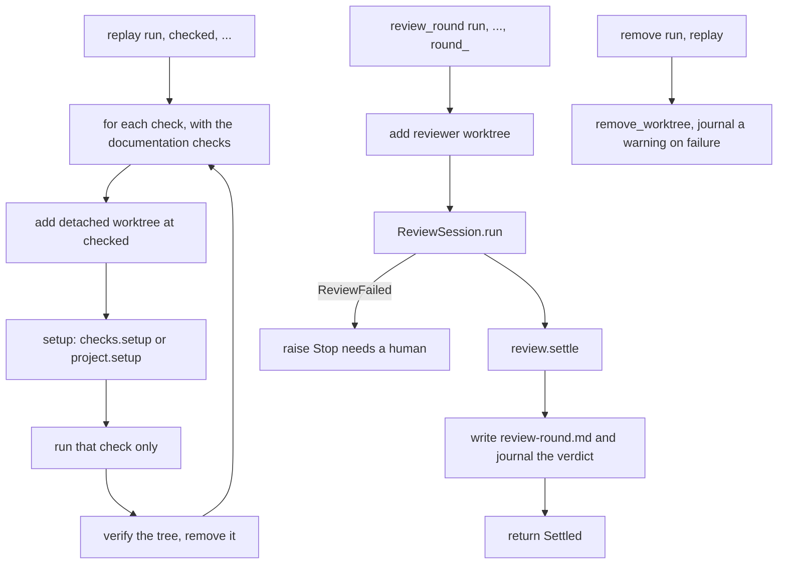
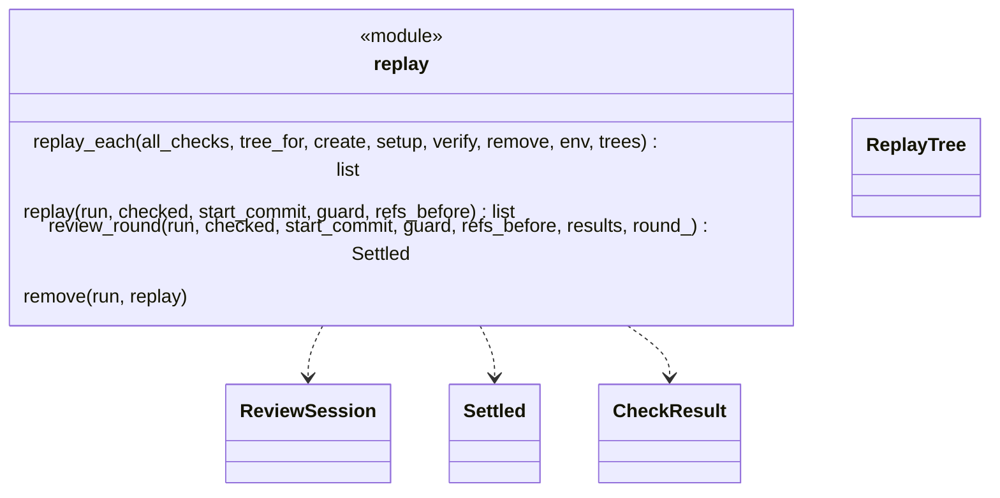
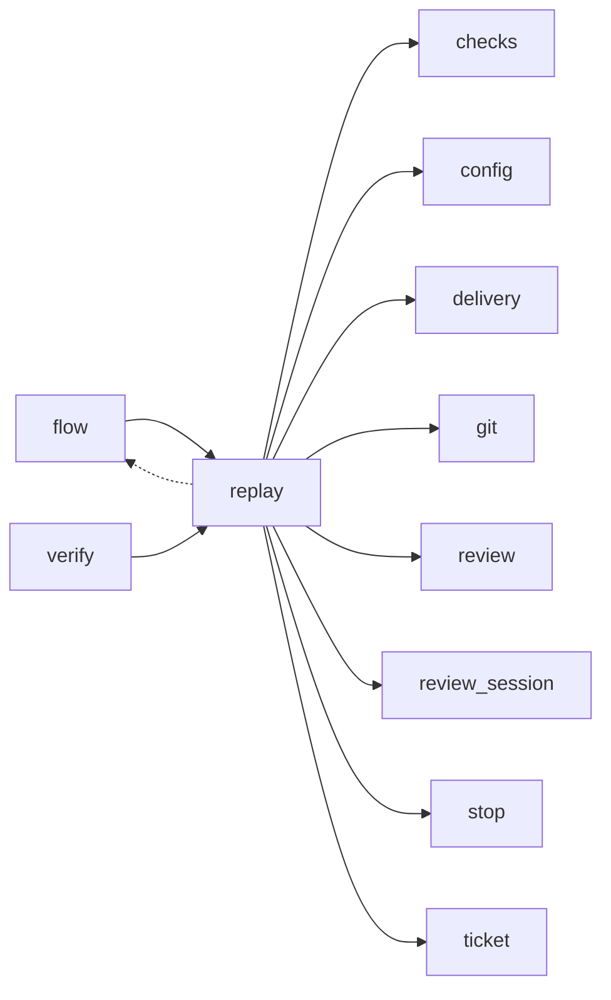

# Module `ariane.replay`

One round of replay and review of a ticket, moved out of `flow` unchanged (ADR 0034): each check in its own clean working tree (C9, ADR 0041), then the read-only reviewer on a separate tree (C10, C26).

## Public API

| Name | Kind | What it does |
| --- | --- | --- |
| `ReplayTree` | dataclass | One check's tree: `check`, `path`, `setup_s` (the setup's duration). |
| `replay_each(all_checks, tree_for, create=, setup=, verify=, remove=, env=, trees=)` | function | The loop shared by `start` and `verify`: per check, a fresh tree, its setup, that check only, a verification, then removal (also on a stop or Ctrl-C). |
| `replay(run, checked, start_commit, guard, refs_before)` | function | Replays every check in its own clean tree at the delivered commit; returns the results. |
| `review_round(run, checked, start_commit, guard, refs_before, results, round_)` | function | Runs review `round_` on the reviewer tree and returns the settled review. |
| `remove(run, replay)` | function | Removes a replay or reviewer tree, journaling a warning if it cannot. |
| `record_truncation(folder, diff)` | function | Journals `ticket.review.diff_truncated` with the files whose hunks the reviewer's diff lacks; returns them (empty when the diff is not cut). |

## Behaviour and errors

- `replay_each`: for each check in order creates a fresh detached tree (`<n>-replay-<k>`, `verify-<slug>-<k>`), runs the setup (`checks[].setup`, else `project.setup`), runs that check only, verifies, removes the tree. A leftover tree of that name refuses. The setup duration is not part of the check's duration.
- `replay`: `replay_each` for a ticket; a setup stop names the check whose tree it was; journals `ticket.checks.worktree`, one line per check; returns the results (no tree is kept, the reviewer has its own).
- `review_round`: review `round_` on the reviewer tree, with the diff and its untruncated `git diff --name-status`; when the diff is cut, `record_truncation` journals the missing files and `run.truncated` keeps them for the pull request body (ADR 0031); writes `review-<round>.md`, journals the verdict and tells the metrics the first-pass verdict.
- `remove`: removes a replay or reviewer tree, journaling a warning if it cannot.

## Workflow

## Code view (C4 level 4)

## Collaborations

Arrows go from the importing module to the imported module; a dashed arrow is an import for type checking only.

<!-- generated: collaborations -->

<!-- end generated -->

## Serves

C9, C10, C26; ADR 0018, ADR 0027, ADR 0031, ADR 0034. See [the component view](../3-components.md).
