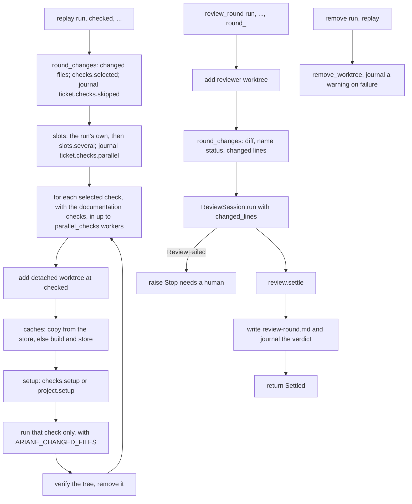
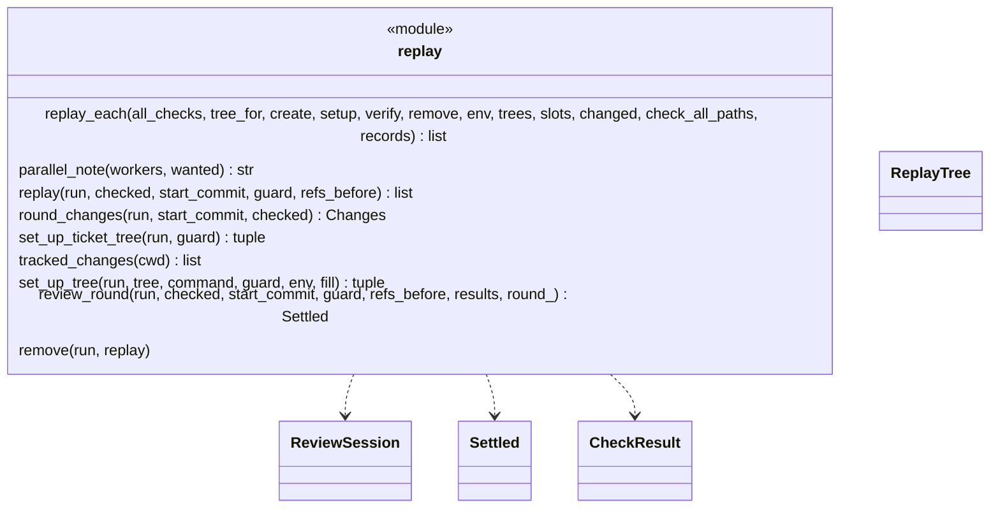
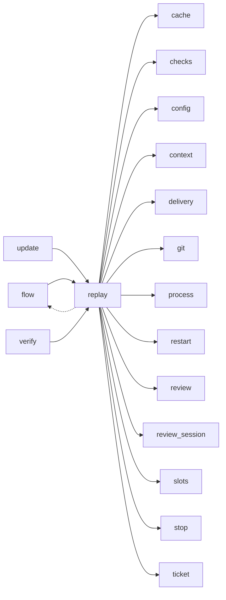

# Module `ariane.replay`

One round of replay and review of a ticket, moved out of `flow` unchanged (ADR 0034): each check in its own clean working tree (C9, ADR 0041), several at the same time with `project.parallel_checks` (ADR 0052), then the read-only reviewer on a separate tree (C10, C26).

## Public API

| Name | Kind | What it does |
| --- | --- | --- |
| `ReplayTree` | dataclass | One check's tree: `check`, `path`, `setup_s` (the setup's duration), `slot` (the worker's slot in a parallel replay, else `None`), `caches` (what its dependency caches did, `cache.lines`, `""` without any). |
| `replay_each(all_checks, tree_for, create=, setup=, verify=, remove=, env=, trees=, slots=(), changed=None, check_all_paths=(), records="")` | function | The loop shared by `start` and `verify`: per check, a fresh tree, its setup (`setup(check, tree, env)`), that check only, a verification, then removal (also on a stop or Ctrl-C); `setup` returns the tree's `cache.lines`; with several `slots`, one worker thread per slot (ADR 0052); with the `changed` files, only the checks they select run, the others are skipped, and each check that runs gets `ARIANE_CHANGED_FILES` (ADR 0056). |
| `parallel_note(workers, wanted)` | function | The journal text of a parallel replay: how many checks ran at once, in which slots, and that fewer slots than `wanted` were free when it is so. |
| `replay(run, checked, start_commit, guard, refs_before)` | function | Replays each check the round's change selects in its own clean tree at the delivered commit; returns the results, the skipped checks included. |
| `round_changes(run, start_commit, checked)` | function | The round's `git.Changes` from the start commit to `checked`, without `work/`, read once per replayed commit (kept in `run.changes`) for the selection of the checks and for the review. |
| `set_up_ticket_tree(run, guard)` | function | The ticket's own tree at the start: with `[[project.cache]]`, old cache entries pruned (`cache.prune`), the caches copied or built but never stored, then `project.setup`; returns the `ticket.setup` note on the caches and the setup's stop, or `None`. |
| `tracked_changes(cwd)` | function | Tracked paths changed in the files or the index (`git.status`, untracked ones left out): a cache setup that changed one stores nothing (ADR 0054). |
| `set_up_tree(run, tree, command, guard, env=None, fill=, head="")` | function | The dependency caches (`cache.prepare` on `<repo>.ariane/cache`, each cache's own setup through the guarded `run.setup`), then `command`; after each cache build (before it is stored) and after the copies, the tree must still be at `head` (a replay tree's commit; "a cache setup moved the replay working tree's head"), have no tracked or staged change ("a cache setup changed files that git tracks") and hold no file git does not ignore ("the dependency caches left files that git does not ignore"); returns what the caches did and the first stop, or `None`. |
| `review_round(run, checked, start_commit, guard, refs_before, results, round_)` | function | Runs review `round_` on the reviewer tree and returns the settled review. |
| `remove(run, replay)` | function | Removes a replay or reviewer tree, journaling a warning if it cannot. |
| `truncation_note(diff)` | function | Where the reviewer's diff was cut and the files whose hunks it lacks, or `""` when it is whole (ADR 0031). |
| `record_truncation(folder, diff)` | function | Journals `ticket.review.diff_truncated` with the files whose hunks the reviewer's diff lacks; returns them (empty when the diff is not cut). |

## Behaviour and errors

- `replay_each`: for each check in order creates a fresh detached tree (`<n>-replay-<k>`, `verify-<slug>-<k>`), runs the setup (`checks[].setup`, else `project.setup`), runs that check only, verifies, removes the tree. A leftover tree of that name refuses; for a ticket (not a shadow run, `run.restartable`) the next action is "run `ariane start <n> --restart`" (ADR 0047), for the reviewer tree too. The setup duration is not part of the check's duration.
- Parallel replay (ADR 0052): with more than one slot, `replay_each` starts one thread per slot; each takes the next check in declared order and replays it in its own tree, with its slot as `ARIANE_SLOT` for its setup and check. Creating and removing a tree are done one worker at a time; setups, checks and verifications run concurrently. The results, and `trees`, are in the declared order whatever the finishing order. The first stop in a worker (a setup failure, a guard failure, any error), Ctrl-C in the calling thread, or a worker thread that fails to start, stops the others: no new check is taken, `process.cancel` kills their running commands and refuses their next ones except tree creation and removal (`process.shielded`), every tree is removed, then that first stop is raised. The calling thread waits for an event each worker sets after removing its tree, never on `Thread.join` alone (on Python 3.11 a join interrupted by Ctrl-C can take a running thread for stopped), so the slots are released only once every tree is gone. With one slot or none, the checks run one by one in the calling thread, as before.
- Selective checks (C9, ADR 0056): given `changed`, `replay_each` runs only the checks `checks.selected` keeps (every one when the change touches `ariane.toml` or a `project.check_all_paths` file; else those without `paths`, the documentation checks among them, and those whose `paths` match a changed file) and records the others with `checks.skipped_result`, in the declared order. A changed path whose name holds a line break stops the replay before any tree is made ("a changed file's name holds a line break: changed-files.txt cannot list it", the names in the detail): the one-per-line list would read it as two paths. Before each check that runs, `checks.changed_files_listing` writes the changed files, one per line, to `<records>/changed-files.txt` in that check's tree, the check gets its absolute path as `ARIANE_CHANGED_FILES` (set after the environment is built, not a project variable), and the file is never removed by name: the tree is removed after the check, the file with it, and the tree verification of `ariane verify` leaves that one path out (`checks.without_listing`). The file is made through folder handles (POSIX), so a link met on the way never makes Ariane write outside the tree (a folder moved out after it was opened is an accepted residual, ADR 0056); a link on the way or a file the commit holds stops with "the replayed commit holds work/<n>/changed-files.txt, or its folder leads outside the replay tree".
- `replay`: `replay_each` for a ticket, with the changed files of the round (`checks.changed_files` of `round_changes`, renames on both sides) and `min(project.parallel_checks, number of selected checks)` workers wanted (at least one); when some checks are not selected it journals `ticket.checks.skipped` with their names: the run's own slot and as many more as `slots.several` gets; when more than one is wanted it journals `ticket.checks.parallel` (`parallel_note`) before the first check; each setup is followed, before its check runs, by the comparison of git and the reviewer's instruction files with the guard's snapshot (`run.setup(tree, command, guard)`); a setup stop names the check whose tree it was; journals `ticket.checks.worktree`, one line per check (with its slot in a parallel replay); returns the results (no tree is kept, the reviewer has its own). Each check's tree is checked unmoved with `git.detached_head` (one git process) and the run verified with `run.verify`, the remote listed after each check (ADR 0053): a check that changes the remote stops the ticket before the next check runs and before the review, with "the remote changed during the checks", so a later check cannot undo the change unseen.
- Dependency caches (C9, ADR 0054): with `[[project.cache]]`, each replay tree's setup is `set_up_tree(..., fill=True)`: every cache is copied from a complete store entry with its key, else built by its own setup (guarded like any setup, a failure naming the check) and stored; `checks[].setup` or `project.setup` then runs. The journal's `ticket.checks.cache` lists, per check, each cache hit or built (and whether it was stored), after `ticket.checks.worktree`. Without `[[project.cache]]` nothing is pruned, copied or journaled.
- `set_up_ticket_tree`: before the implementer starts, and only with `[[project.cache]]` (the store of caches no longer declared is left alone), `cache.prune` keeps each path's `keep` most recently used entries, then the ticket's own tree gets its caches with `fill=False`: a hit is copied, a miss built and never stored, since the agent works in that tree; `ticket.setup` names the caches and the removed entries.
- `review_round`: review `round_` on the reviewer tree, with the diff and its untruncated `git diff --name-status`; it takes the diff, its name status and the changed lines of the reviewed range from `round_changes` (one git process per round, read by the replay for the selection, ADR 0053, ADR 0056), recomputed each round since a fix round changes the diff, and passes the count and the small reviewer's environment (`run.agent_envs["reviewer.small"]`) to `ReviewSession`, which chooses the reviewer settings (`[agents.reviewer.small]` when the count is at most `max_lines`, ADR 0046) and records `changed_lines` in the metrics; `review-<round>.md` names the model of the selected reviewer; when the diff is cut, `record_truncation` journals the missing files and `run.truncated` keeps them for the pull request body (ADR 0031); writes `review-<round>.md`, journals the verdict and tells the metrics the first-pass verdict.
- `remove`: removes a replay or reviewer tree, journaling a warning if it cannot.

## Workflow

## Code view (C4 level 4)

## Collaborations

Arrows go from the importing module to the imported module; a dashed arrow is an import for type checking only.

<!-- generated: collaborations -->

<!-- end generated -->

## Serves

C9, C10, C26; ADR 0018, ADR 0027, ADR 0031, ADR 0034, ADR 0046, ADR 0047, ADR 0052, ADR 0053, ADR 0054, ADR 0056. See [the component view](../3-components.md).
