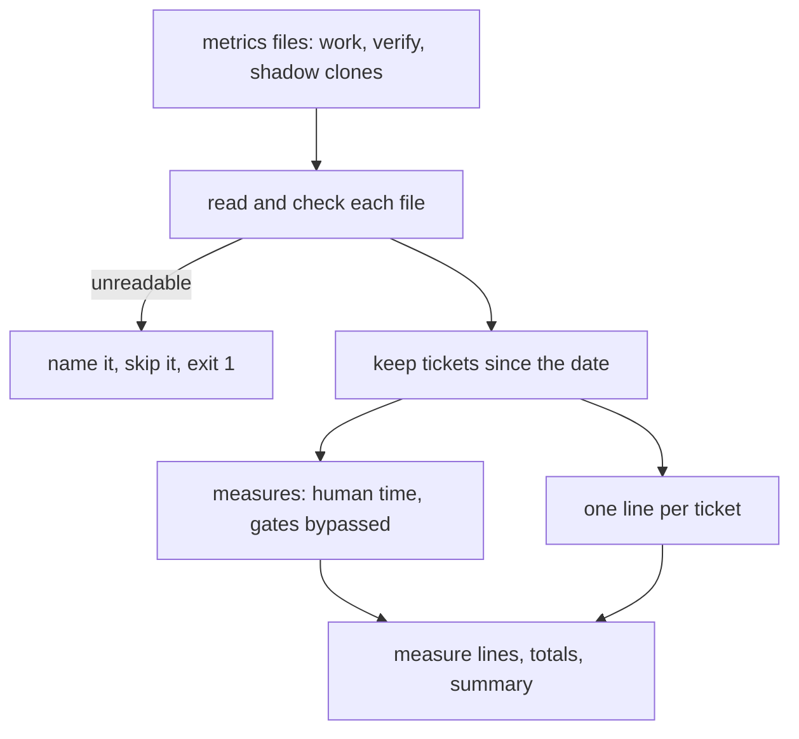
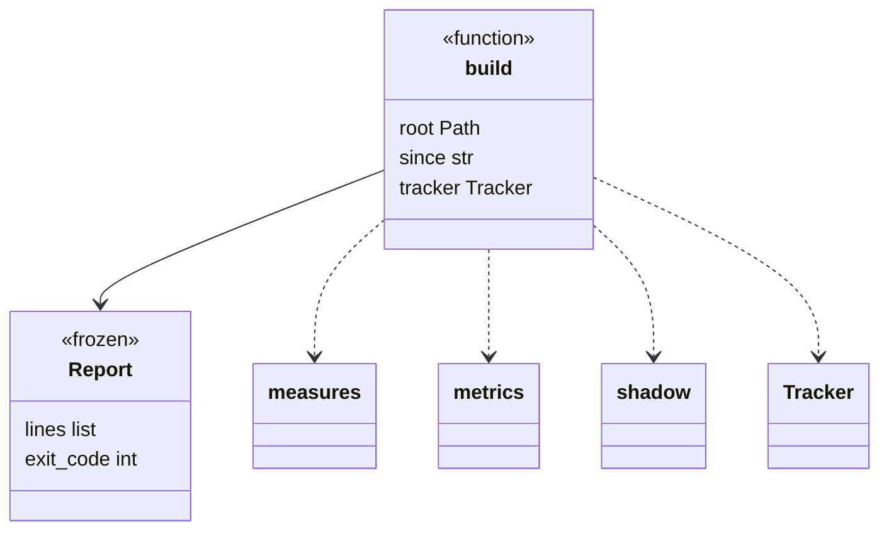
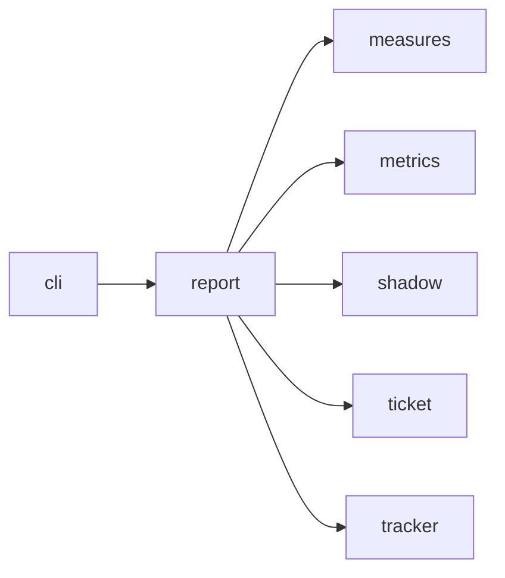

# Module `ariane.report`

`ariane report [--since YYYY-MM-DD]` (C19, C23, ADR 0035): reads the metrics files of the checkout and prints one line per ticket, then totals, then one summary line.

## Public API

| Name | Kind | What it does |
| --- | --- | --- |
| `PARTLY` | constant | `partly not reported`, said of a cost when a session's cost is null. |
| `Report` | class | The result: `lines` and `exit_code`. |
| `build(root, since, tracker=None)` | function | Reads the metrics files and returns a `Report`. |

## Behaviour and errors

- `build` reads `work/*/metrics.json`, `work/verify/**/metrics.json` (a hand-takeover record shows its branch) and the shadow clones (`<repo>.ariane/shadow/<n>/work/<n>/metrics.json`); it writes nothing. It keeps tickets started on or after `since` and prints number, mode, outcome, cost ("partly not reported" when a session's cost is null), agent time, rounds and first-pass verdict.
- Before the totals it prints `Human time:` (waiting, restarts, shadow minutes judged, per merged pull request), `Gates bypassed:` and the `Shadow:` totals with `shadow pass: yes|no` (C19, ADR 0038). Each delivered ticket's line gets its human time and gates bypassed; a shadow ticket's line gets its judgement.
- Totals give tickets, cost, agent time, rounds and the first-pass go rate (go / reviewed).
- Without a tracker (no token, no configuration) or when it fails, the waiting time reads "not available".
- A file that cannot be read or has a field of the wrong type is named and skipped, and the exit code is 1. No metrics file at all gives one line and exit code 0.

## Workflow

## Code view (C4 level 4)

## Collaborations

Arrows go from the importing module to the imported module; a dashed arrow is an import for type checking only.

<!-- generated: collaborations -->

<!-- end generated -->

## Serves

C19, C23; ADR 0012, ADR 0030, ADR 0035, ADR 0038. See [the component view](../3-components.md).
