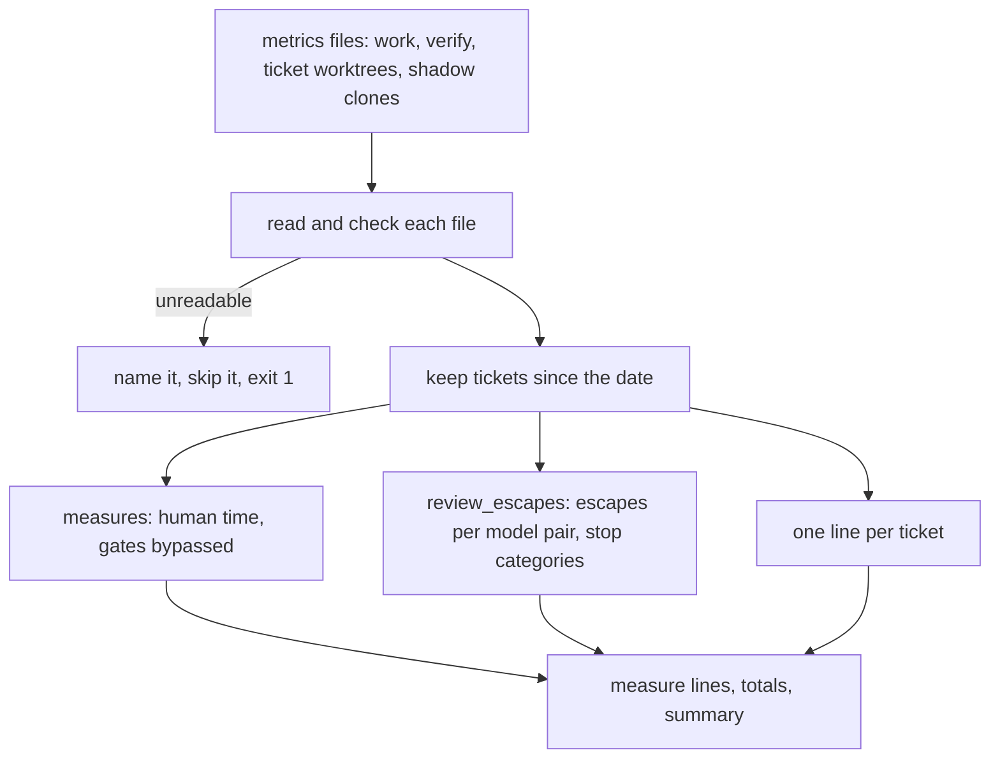
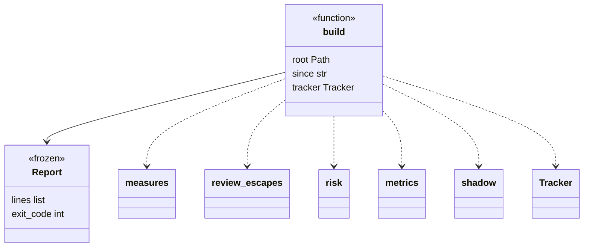
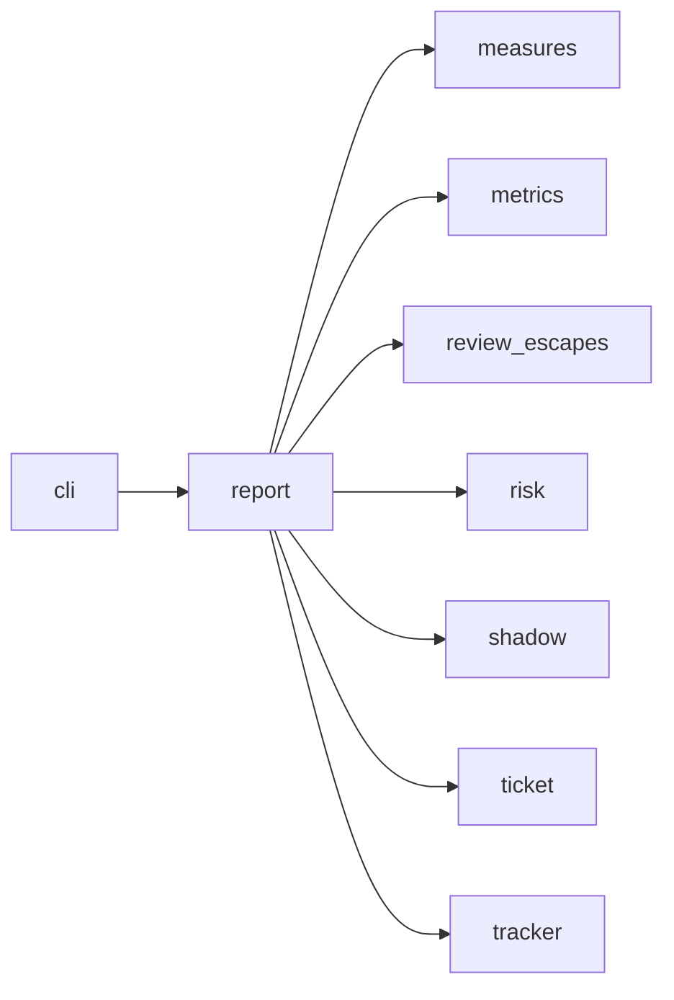

# Module `ariane.report`

`ariane report [--since YYYY-MM-DD]` (C19, C23, ADR 0035): reads the metrics files of the checkout and prints one line per ticket, then totals, then one summary line.

## Public API

| Name | Kind | What it does |
| --- | --- | --- |
| `PARTLY` | constant | `partly not reported`, said of a cost when a session's cost is null. |
| `COVERED` | constant | `covered by plan`, said of sessions whose `billing` is `plan`. |
| `OUTSIDE` | constant | `kept outside`, the key `build` sets on a stop kept outside the repository: its own attempt, never replaced by a run's record. |
| `WORKTREES` | constant | `worktrees`, the folder of the ticket worktrees in `<repo>.ariane`, as `flow.worktree_path`. |
| `Report` | class | The result: `lines` and `exit_code`. |
| `build(root, since, tracker=None, max_escape_rate=0.02)` | function | Reads the metrics files and returns a `Report`. |

## Behaviour and errors

- `build` reads `work/*/metrics.json`, `work/verify/**/metrics.json` (a hand-takeover record shows its branch), the ticket worktrees (`<repo>.ariane/worktrees/<n>/work/<n>/metrics.json`), the shadow clones (`<repo>.ariane/shadow/<n>/work/<n>/metrics.json`) and the stops kept outside the repository: `<repo>.ariane/stopped/**/metrics.json` (a stop in the first setup, ADR 0031; a start refused before its run, `metrics.keep_refused`, ADR 0058) and `<repo>.ariane/verify/<slug>/metrics.json` (a verification that ended without committing; it shows the branch's slug); it writes nothing. A ticket worktree holds the latest record of its run: the full replay after delivery is committed only there, after the push (ADR 0056). Its record replaces the merged record of the same run (same ticket and `started`), and a run not merged yet is added; a hand-takeover record and a stop kept outside the repository (`OUTSIDE`) are their own attempts and are never replaced, since a start refused on the lock can share a run's `started` second. It keeps tickets started on or after `since` and prints number, mode, outcome, cost ("partly not reported" when a session's cost is null), agent time, rounds and first-pass verdict, then `recurring_findings N` when the record has it (ADR 0059).
- Before the totals it prints `Human time:` (waiting, restarts, shadow minutes judged, per merged pull request), `Gates bypassed:` and the `Shadow:` totals with `shadow pass: yes|no` (C19, ADR 0038). Each delivered ticket's line gets its human time and gates bypassed; a shadow ticket's line gets its judgement. Then the "Selective checks" line (`measures.selective_lines`: tickets with selection, replay time with selection versus the full replays' time on the sampled tickets, full replays, escapes and escape rate), with a warning when the rate is above `max_escape_rate` (`[checks_policy]`, read by `cli`; ADR 0056).
- Then the review escapes (C10, C19, ADR 0058, `review_escapes.lines`): one line per implementer model, reviewer model and reviewer runtime with recorded verdicts (reviews, tickets, `go` verdicts, findings per review, escapes, and the escape rate, escapes over the `go` tickets the tracker described, shown from 5 tickets), a line when the tracker or the CI data is missing, and "Escape rates compared:" when two groups or more show a rate. Then "Stopped by category:" over the tickets that did not end delivered green, and the same per implementer model (`review_escapes.category_lines`).
- Plan-billed sessions (`billing` = `plan`) are not summed in dollars: a ticket or the totals show "covered by plan" instead of an amount, or after the amount of the other sessions (ADR 0043). Totals give tickets, cost, agent time, rounds and the first-pass go rate (go / reviewed).
- Without a tracker (no token, no configuration) or when it fails, the waiting time reads "not available".
- A file that cannot be read or has a field of the wrong type (a `category` that is not a string, a `recurring_findings` that is not an integer, a `full_replay` object included, `measures.check_full_replay`) is named and skipped, and the exit code is 1. No metrics file at all gives one line and exit code 0.

## Workflow

## Code view (C4 level 4)

## Collaborations

Arrows go from the importing module to the imported module; a dashed arrow is an import for type checking only.

<!-- generated: collaborations -->

<!-- end generated -->

## Serves

C10, C19, C23; ADR 0012, ADR 0030, ADR 0035, ADR 0038, ADR 0056, ADR 0058, ADR 0059. See [the component view](../3-components.md).
