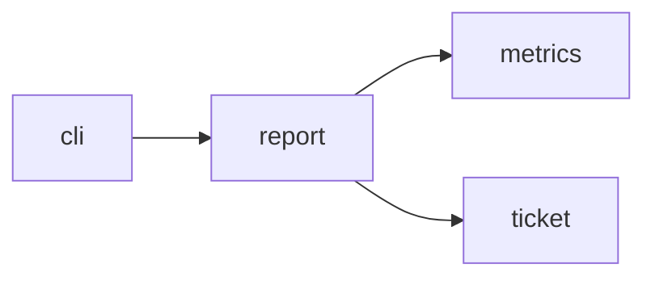

# Module `ariane.report`

`ariane report [--since YYYY-MM-DD]` (C19, C23, ADR 0035): reads the metrics files of the checkout and prints one line per ticket, then totals, then one summary line.

## Main types and functions

- `build(root, since)`: returns a `Report` (lines, exit code). Reads `work/*/metrics.json` and `work/verify/*/metrics.json`, keeps tickets started on or after `since`, prints number, mode, outcome, cost ("partly not reported" when a session's cost is null), agent time, rounds and first-pass verdict. Totals give tickets, cost, agent time, rounds and the first-pass go rate (go / reviewed). A file that cannot be read is named and skipped, and the exit code is 1.

## Collaborations

Arrows go from the caller to the callee.

## Serves

C19, C23; ADR 0012, ADR 0030, ADR 0035. See [the component view](../3-components.md).
