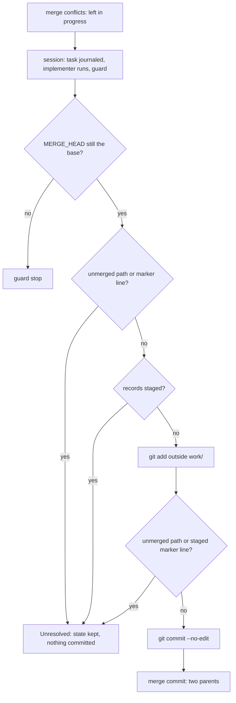
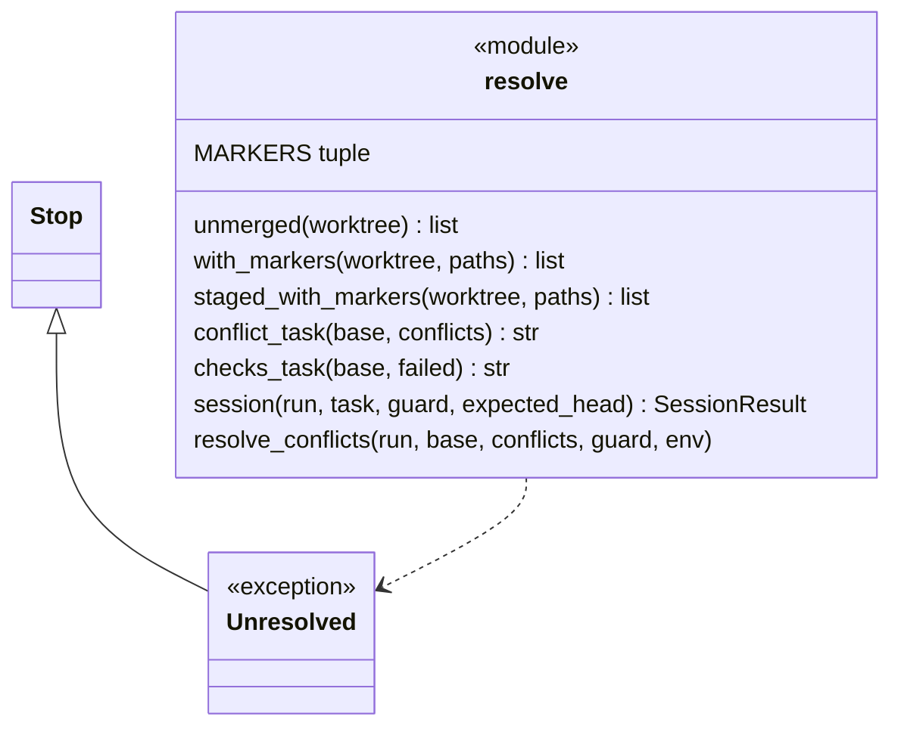
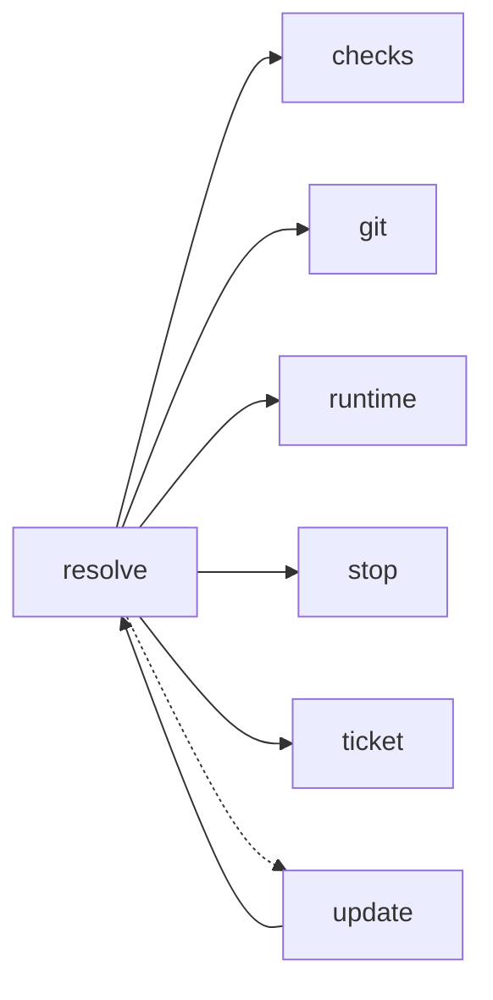

# Module `ariane.resolve`

The implementer session of `ariane update <n>` (C10, C11; ADR 0033): when merging the base branch conflicts, or a clean merge leaves blocking checks red, one implementer session gets that conflict or that failure as its task. It is the first of the fix rounds of C10; `update` then replays, reviews and pushes on go. For a conflict, this module checks the session's resolution and commits the merge.

## Public API

| Name | Kind | What it does |
| --- | --- | --- |
| `MARKERS` | constant | The conflict marker line starts a resolution must not leave: `<<<<<<< ` and `>>>>>>> `. |
| `Unresolved` | exception | A `Stop`: a merge neither finished nor undone (an abort that did not restore the tree, conflicts the update session left). The state is kept for a human and nothing is committed. |
| `unmerged(worktree)` | function | The paths git holds as not merged (`git ls-files -u -z`), sorted. |
| `with_markers(worktree, paths)` | function | The `paths` whose regular file (not a link) holds a line that starts with a conflict marker. |
| `staged_with_markers(worktree, paths)` | function | The `paths` whose staged blob (`git cat-file blob :0:<path>`, what the commit takes) holds a line that starts with a conflict marker; a path not in the index is skipped. |
| `conflict_task(base, conflicts)` | function | The task for a conflict: "Merge `<remote>/<base>` into this branch: resolve the conflicts below, keeping both sides' intent; mark each path resolved with `git add`; do not commit.", then the paths. |
| `checks_task(base, failed)` | function | The task for checks red after a clean merge: "These checks fail after merging `<remote>/<base>`: fix them.", then each check's name, result and output as `checks.md` shows it (`checks.shown_output`). |
| `session(run, task, guard, expected_head)` | function | The update's implementer session: journals `ticket.update.implementer` with the task, sets the status `updating`, runs `flow._TicketRun._implement(task=…)`, then the guard of `flow` ("the update session"), with the head expected at `expected_head` when given, and warns about new ignored files. |
| `resolve_conflicts(run, base, conflicts, guard, env)` | function | Runs the session for a conflict on the merge left in progress, checks its work, then commits the merge. |

## Behaviour and errors

- The task goes to the agent in the prompt's untrusted block `kind="update"` (`context.implementer_prompt(update=…, task=…)`). Every prompt of the update says it is an update of a delivered ticket, not a fresh one. The recorded context points to the journal entry "Update session's task", which holds the task.
- Conflict (`resolve_conflicts`): the merge is not aborted. The session must not move the head (the guard expects the head the update started at). After the session:
  - the merge no longer in progress (no `MERGE_HEAD`, or one that is not the fetched base): a guard violation, "the update session ended the merge of `<base>`";
  - a path still unmerged (`unmerged`), or a conflicting path whose file or staged blob still holds a conflict marker line (`with_markers`, `staged_with_markers`): `Unresolved`, "the update session left conflicts in `<paths>`", category `merge`;
  - entries under `work/` staged by the session (`git ls-files -s -- work` differs from before it): `Unresolved` and a guard violation.

  Each of these stops the update with nothing committed or pushed: an `Unresolved` keeps the merge state, and the journal entries of the session stay in the working tree, uncommitted. Otherwise Ariane stages everything outside `work/`, checks the index again for an unmerged path or a staged marker line (`git add` skips a path marked `--skip-worktree`, so the working copy alone does not show what is committed), and runs `git commit --no-edit` with the untrusted environment and its identity, so the merge commit keeps both parents. The journal gets "Merge committed". A session that did not finish (budget, time, error) then stops the update, with the resolved merge kept on the local branch.
- Red checks after a clean merge: `update` runs `session` with `checks_task` (no expected head: the agent may commit, as in `start`), then commits the agent's work as `#<n>: fix after merging <base>` (`flow._TicketRun._commit_agent_work`).

## Workflow

## Code view (C4 level 4)

## Collaborations

Arrows go from the importing module to the imported module; a dashed arrow is an import for type checking only.

<!-- generated: collaborations -->

<!-- end generated -->

## Serves

C10, C11; ADR 0033. See [the component view](../3-components.md).
