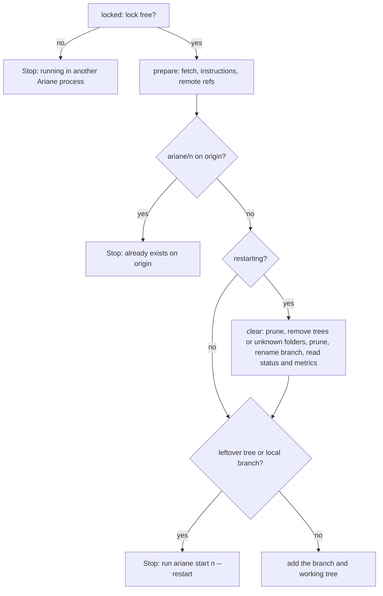
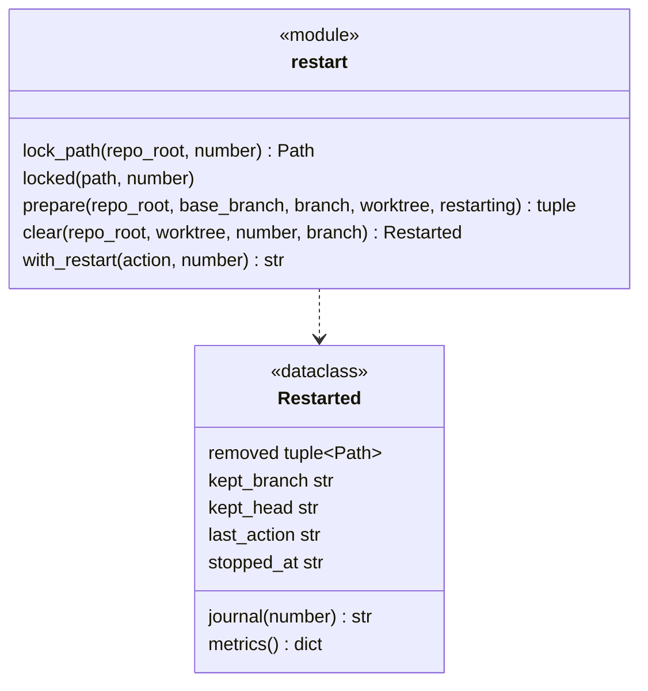
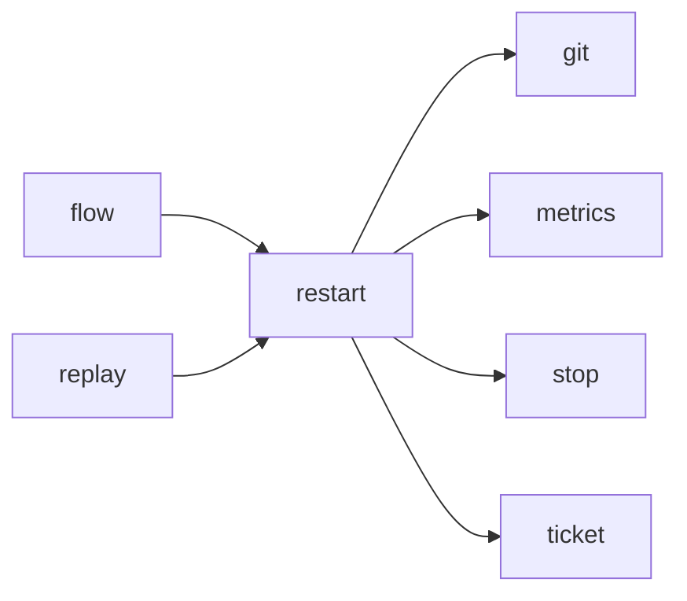

# Module `ariane.restart`

`ariane start <n> --restart` (C5, C23, ADR 0047): the ticket lock that tells a live `ariane start <n>` from a dead one, the preparation of a ticket's branch and working tree, and starting a stopped or interrupted ticket over while keeping its previous branch.

## Public API

| Name | Kind | What it does |
| --- | --- | --- |
| `REMOTE` | constant | The remote name, `origin`. |
| `LOCKS` | constant | `locks`, the folder of the ticket locks under `<repo>.ariane/`. |
| `KEPT_PREFIX` | constant | `ariane-restarted`, the prefix of a kept branch. |
| `kept_name(number)` | function | `ariane-restarted/<n>-<UTC time as YYYYMMDDTHHMMSSZ>`, the name a restart keeps the branch under; `flow.start` registers it with the run before `prepare` renames the branch. |
| `lock_path(repo_root, number)` | function | `<repo>.ariane/locks/<n>.lock`. |
| `command(number)` | function | The text `` `ariane start <n> --restart` ``. |
| `with_restart(action, number)` | function | `action` followed by "; to start over, run `ariane start <n> --restart`", a trailing ", then start (the ticket) again" dropped; unchanged when it already names the command. |
| `locked(path, number)` | context manager | Holds the ticket's lock for the block, without waiting; held by another process: `Stop` "ticket #<n> is running in another Ariane process". |
| `prepare(repo_root, base_branch, branch, worktree, kept)` | function | Fetches the base branch, reads its instructions and the remote's refs, refuses a pushed branch, clears a previous run when `kept` is not empty (restarting), refuses leftovers, then creates the branch and the working tree; returns the push URL, the remote refs, the instructions and the `Restarted` record (or None). |
| `Restarted` | dataclass | What `--restart` cleared: `removed` trees, `kept_branch`, `kept_head`, the previous run's `last_action` and `stopped_at`; `journal(number)` is the `ticket.restarted` text, `metrics()` the `restarted_from` object. |
| `leftovers(worktree, number)` | function | The ticket's trees that exist: `<n>`, `<n>-review` and every `<n>-replay*`. |
| `clear(repo_root, worktree, number, branch, kept)` | function | Removes those trees (`git worktree remove --force` for a registered one, the folder otherwise, then `git worktree prune`) and renames `ariane/<n>` to `kept`; None when there was nothing to clear. |

## Behaviour and errors

- The lock is an operating-system lock on the whole run of `ariane start <n>`: `fcntl.flock` (exclusive, non-blocking) on POSIX, `msvcrt.locking` (`LK_NBLCK`, one byte) on Windows. Closing the file releases it, and so does the system when the process dies, so a killed run never leaves it held. The file stays; it holds nothing.
- `prepare` checks the remote first: a branch `ariane/<n>` on `origin` refuses, with or without `--restart` ("close its pull request and delete the branch, then start again"). Then, when `restarting`, `clear`; then any leftover tree or local branch refuses with the next action "run `ariane start <n> --restart`".
- `clear` never deletes a branch: the kept branch's name has the UTC time, to the second, of the restart. The previous run's last action is read from `work/<n>/status.md` on the kept branch (Last action, Detail, At), and `stopped_at` is the time of the last step of `work/<n>/metrics.json` there; either is empty when unreadable. Uncommitted files in the removed trees are lost: what the run committed stays on the kept branch.
- `clear` prunes first, then removes each leftover: a working tree git has registered with `git worktree remove --force`; a folder at the ticket's tree path that git does not know (a killed run left it before registering it, or an agent created it) is in Ariane's own `<repo>.ariane/worktrees/` and is removed as a folder (read-only files made writable first, for Windows); a link in its place is unlinked, never followed.
- The kept name is registered with the run (`runs.Run.kept`) before the rename, so another ticket's push guard tolerates that one branch appearing while this run is live or witnessed (ADR 0017, ADR 0047); any other `ariane-restarted/...` branch still stops it.
- A failing git command raises `git.GitError`; the flow reports it as a stop before the ticket started.

## Workflow

## Code view (C4 level 4)

## Collaborations

Arrows go from the importing module to the imported module; a dashed arrow is an import for type checking only.

<!-- generated: collaborations -->

<!-- end generated -->

## Serves

C5, C11, C19, C23; ADR 0047. See [the component view](../3-components.md).
