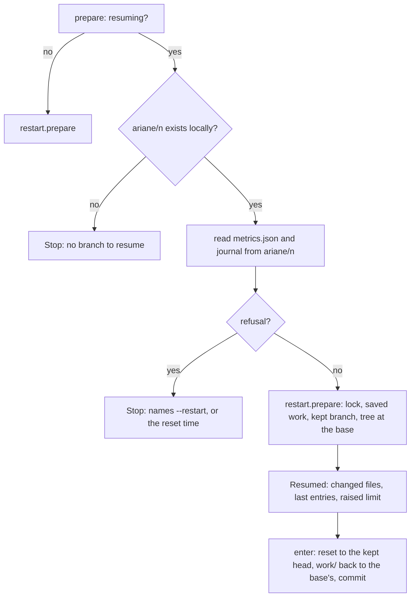
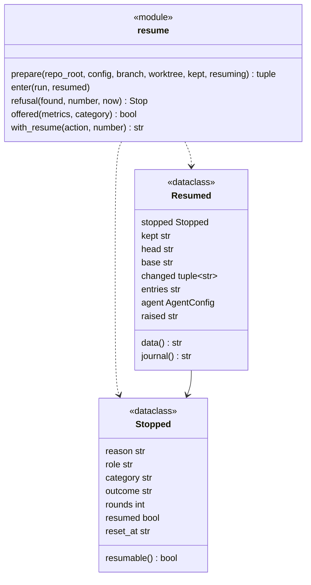
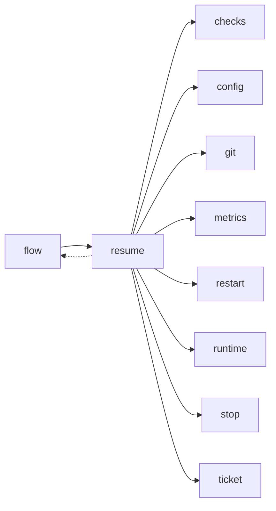

# Module `ariane.resume`

`ariane start <n> --resume` (C5, C23, ADR 0062): a ticket stopped by its implementer's budget, turn or time limit, or by an agent runtime's quota, continues from the work its previous run saved. The restart steps of ADR 0047 run as for `--restart`, then the new branch starts from the kept branch's head, its first implementer session is told it continues an interrupted attempt and gets the limit that stopped it raised once.

## Public API

| Name | Kind | What it does |
| --- | --- | --- |
| `LIMITS` | constant | The stop reasons of a limit: `budget`, `turns`, `timeout`. |
| `QUOTA` | constant | `quota`, the stop reason of a runtime's usage limit (ADR 0043). |
| `ENTRIES` | constant | 4: the previous run's last journal entries given to the resumed session. |
| `ENTRY_CHARS` | constant | 2000: where each of those entries is cut. |
| `command(number)` | function | The text `` `ariane start <n> --resume` ``. |
| `with_resume(action, number)` | function | `action` followed by "; to continue from its saved work, run `ariane start <n> --resume` (or `ariane start <n> --restart`)": the stop line of a limit or quota stop. |
| `Stopped` | dataclass | How a run stopped, from its `metrics.json`: its last session's `reason` and `role`, the run's `category` and `outcome`, its `rounds`, whether it was `resumed` itself, the quota's `reset_at`, the `turns` its last session took (None when not reported); `limit` and `resumable()`. |
| `stopped(data)` | function | The `Stopped` of a `metrics.json`'s data; None without a readable session. |
| `read(text)` | function | `stopped` of a `metrics.json`'s text; None when it is not a JSON object. |
| `offered(metrics, category)` | function | Whether the stop line of a run stopping with `category` names `--resume` (`Stopped.resumable` of its own measurements). |
| `refusal(found, number, now)` | function | The `Stop` that refuses `--resume`, or None: no readable session, a limit stop of a run resumed already, a stop that is not a limit or quota, or a quota before its reset time. |
| `Resumed` | dataclass | What a resumed run continues: the `stopped` record, the `kept` branch and its `head`, the `base` the diffs start from, the files `changed`, the journal `entries`, the resumed session's `agent` (None: the review only) and the `raised` sentence; `data()` is what the session is told, `journal()` the `ticket.resumed` text. |
| `raised(agent, reason, turns=None)` | function | `agent` with the limit of `reason` raised by `resume_factor` and capped (`max_budget_usd`, and `max_tokens` when set, after `budget`; `timeout_minutes` after `timeout`; after `turns`, `max_turns`, else the `turns` the stopped session took, rounded up, and nothing when neither is known; nothing after a quota), and the journal's sentence. |
| `last_entries(journal)` | function | The journal's last `ENTRIES` entries, the "session started" ones (a prompt) left out, each cut short. |
| `prepare(repo_root, config, branch, worktree, kept, resuming)` | function | `restart.prepare` when not `resuming`; else reads the previous run's `metrics.json` and journal from `ariane/<n>` (Ariane's commits), refuses with `refusal` before anything is cleared, runs `restart.prepare` and builds the `Resumed` record from the kept branch. Returns the push URL, the remote refs, the instructions, the `Restarted` record (`resumed` true) and the `Resumed` record (or None). |
| `enter(run, resumed)` | function | Moves the run's new branch to the kept head (`git reset --hard`), brings `work/` back to the base's in a commit of its own, and sets the run's `resumed`, `resume_next`, `diff_base` and `metrics.rounds`. |

## Behaviour and errors

- `--resume` is allowed when the previous run's last agent session stopped on `budget`, `turns` or `timeout` and was the implementer's (round 0 or a fix round) with the run's stop category `budget`, or stopped on `quota` (any role) with the category `runtime`. Any other stop, a check failure, a review hand-over or a guard stop after the session, refuses and names `--restart`. An idle stop is recorded as `timeout` (ADR 0045) and resumes as one.
- A run resumed already (`restarted_from.resumed`) that stops on a limit again refuses `--resume` and names `--restart` or a hand takeover with `ariane verify`; its stop line names only `--restart`.
- A quota stop whose runtime gave a reset time (`reset_at` of the session in `metrics.json`) refuses `--resume` before that time and names it.
- The refusals come before the restart clears anything: the trees and the branch stay as they were. A refusal is a stop before the ticket started (`keep_refused`).
- The new branch is created at the base, so that the run reads the base's ADRs (`review.residuals_in`), then `enter` moves it to the kept head. `work/` is restored to the merge base's: the previous run's records and anything an agent left there go, and the new run's records start empty as for `--restart`.
- The changes the checks select, the risk tier weighs and the reviewer reads start at `diff_base`, the merge base of the kept head and the base branch, not at the new run's start commit; the guard's history check still starts at the start commit.
- After a reviewer's quota stop, the run has no implementer session: it replays the checks and reviews the kept head, the fix rounds already used counting against C10's limit (`metrics.rounds` continues from the previous run's).

## Workflow

## Code view (C4 level 4)

## Collaborations

Arrows go from the importing module to the imported module; a dashed arrow is an import for type checking only.

<!-- generated: collaborations -->

<!-- end generated -->

## Serves

C5, C10, C23; ADR 0062. See [the component view](../3-components.md).
