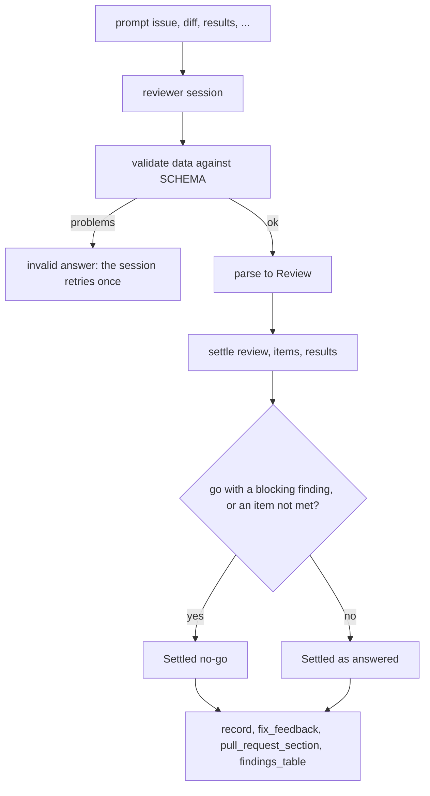
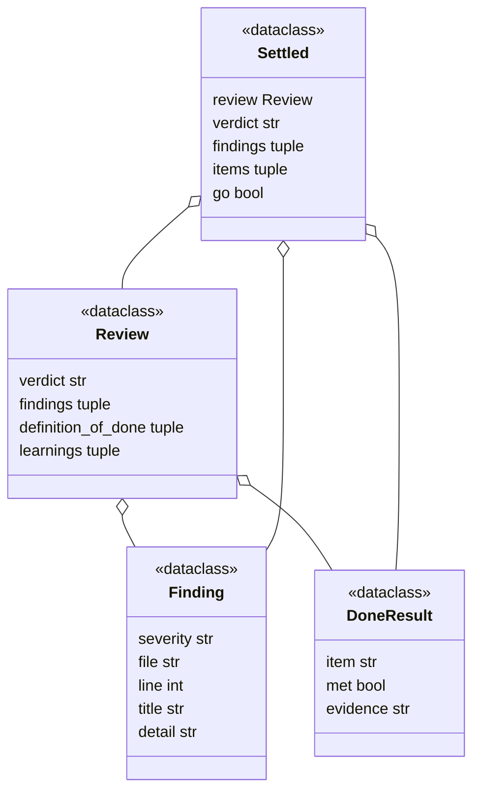
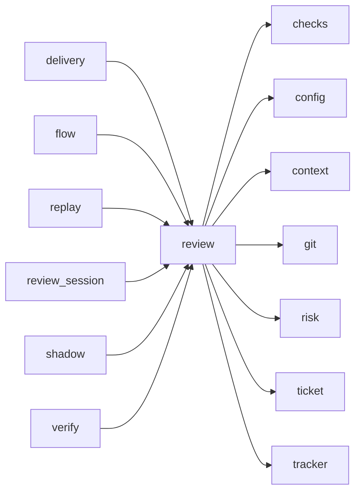

# Module `ariane.review`

The adversarial review (C10) and the definition-of-done answers (C26): the reviewer's prompt, the description and validator of its answer, and the rules Ariane applies to it.

## Public API

| Name | Kind | What it does |
| --- | --- | --- |
| `MAX_DIFF_CHARS` | constant | The diff size given to the reviewer, in characters. |
| `PULL_REQUEST_LIMIT` | constant | Characters of review the pull request body carries before a summary and a link. |
| `SCHEMA` | constant | The JSON Schema of the reviewer's answer. |
| `RESIDUAL_MARKER` | constant | `- **Accepted residual.**`: how an ADR starts an item recording a residual the owner accepted (ADR 0057). |
| `ADR_FOLDER` | constant | `docs/adr`, where the accepted residuals are read. |
| `Residual` | dataclass | An accepted residual: `adr` (its four-digit number) and `text`. |
| `accepted_residuals(cwd, commit)` | function | The accepted residuals of the ADRs in `docs/adr/` at `commit` (ADR 0057). |
| `residuals_in(tree)` | function | The accepted residuals of the ADR files in `tree`'s `docs/adr/`, read without git: `ariane start` reads them in the ticket's fresh working tree, at the base commit (ADR 0057). |
| `residual_items(text)` | function | The text of each item of an ADR that starts with `RESIDUAL_MARKER`, continuation lines joined. |
| `Finding` | dataclass | A finding: `severity`, `file`, `line`, `title`, `detail`. |
| `DoneResult` | dataclass | The answer to one definition-of-done sentence: `item`, `met`, `evidence`. |
| `Review` | dataclass | The reviewer's answer: `verdict`, `findings`, `definition_of_done`, `learnings`. |
| `Settled` | dataclass | A review after Ariane's rules: `verdict`, `findings`, `items`; `go` says whether it passes. |
| `validate(data)` | function | The problems of an answer against the schema; empty when valid. |
| `parse(data)` | function | Turns a valid answer into a `Review`. |
| `settle(review, items, results)` | function | Applies Ariane's rules to a review and the check results. |
| `prompt(issue, diff, results, check_configs, items, ...)` | function | The reviewer's instructions with the untrusted data; with `changed`, a block naming the changed files whose tests no replay ran (`not_run_locally`, ADR 0042); with `name_status`, the full list of changed files; with `small_lines`, the narrower review of a small change (ADR 0046); with `residuals` and `sensitive`, the accepted residuals of the base commit and the changed sensitive paths (ADR 0057). |
| `small_note(lines)` | function | The sentence a small change's prompt adds (ADR 0046). |
| `truncated_paths(diff, limit=MAX_DIFF_CHARS)` | function | The files whose hunks are missing or incomplete when the diff is cut at `limit` characters; empty when it is not cut. |
| `findings_table(settled)` | function | The findings as a Markdown table. |
| `record(settled, commit, model, round_)` | function | The text of `work/<n>/review-<round>.md`. |
| `fix_feedback(settled, failed)` | function | The findings and failed blocking checks given to a fix session. |
| `pull_request_section(settled, review_url, review_path)` | function | The review section of the pull request body. |

## Behaviour and errors

- `SCHEMA`, `validate`, `parse`: the answer's description (also passed to the runtime as `--json-schema`; the Claude Code runtime drops its `$schema`), its validator and its typed form.
- `prompt`: the review instructions, the issue, the diff and the base branch's `CLAUDE.md` under "Project instructions (from the base branch)" (all untrusted data), the checks' summary and the sentence items; when checks were skipped (no changed file matches their `paths`, ADR 0056), a line after the checks table names them as not run; given the round's `tier`, a line "Risk tier of this round: <tier>: <reasons>." follows (ADR 0056).
- No silent truncation (ADR 0031): the prompt always holds `name_status`, the untruncated `git diff --name-status` of the whole range, in its own untrusted block (`kind="changed-files"`), before the diff. A diff over `MAX_DIFF_CHARS` is cut there and ends with "(diff truncated at 200,000 characters)"; the prompt then names the files whose hunks are missing or incomplete (`truncated_paths`, read from the `rename to`, `copy to`, `+++ b/` or `--- a/` line of each file's part, else from its `diff --git` header) in a `kind="paths"` block and tells the reviewer to read them in the tree.
- `settle`: `go` with a blocking finding is `no-go`; a sentence item missing or `met: false` is a blocking finding; check items come from the replay's results.
- `record`: the text of `work/<n>/review-<round>.md`. `fix_feedback`: the findings (and failed blocking checks) given to a fix session. `pull_request_section`: the verdict, the item results and the findings table (3,000 characters at most, else a summary and a link).

When the issue has an `Out of scope` section (`ticket.section`), the prompt shows it again as its own escaped untrusted block (`kind="out-of-scope"`) and the rules say that a finding about that work is never blocking: minor, with "out of scope" in its title, or left out. This is a framed opinion; `settle` is unchanged.

With `small_lines` (a small change, ADR 0046), the prompt adds, between the paragraph on the removed instruction files and the rules, `small_note(small_lines)`: "This change is small (N changed lines). Review the changed files, their tests and the code that calls them; do not survey the rest of the repository." Without it the prompt is unchanged.

Right after the "Be adversarial" rule, the prompt asks the reviewer to check the order of side effects: where the issue, the spec or the code relies on an order, atomicity, idempotent retries or concurrent requests, it follows each request path step by step and lists every write in order. A write before the check that should guard it, a decision split across statements that a concurrent request can interleave, or a retry that can write twice is a blocking finding that names the two steps and the interleaving.

Review in proportion (ADR 0057). The rules always hold the proportion rule: a case that neither the ticket nor the specification asks for, and that no acceptance criterion covers, is minor, unless it loses data, breaks a security property or makes a check pass wrongly; then it stays blocking and its detail says which of the three. Given `residuals` (from the base commit, so that a residual line the change adds is never listed), the rules add that a finding that is one of them is minor, with "accepted residual (ADR NNNN)" in its title, and the prompt lists them, one `- ADR NNNN: <text>` line each, in an escaped `<untrusted-ticket kind="accepted-residuals">` block. Given `sensitive`, the changed files matching `[review] sensitive_paths`, the prompt says the change touches sensitive paths the owner reviews too and lists them in a `kind="paths"` block. Like the out-of-scope rule, these are framed opinions; `settle` is unchanged.

`accepted_residuals` runs `git grep -l --full-name -F` for the marker at the commit under `docs/adr/` (no file: an empty list), then `git show` of each file found, and keeps, with `residual_items`, every line that starts with the marker and the indented, non-blank lines that follow it; the ADR number is the file name's prefix before its first `-`. Another git failure raises `git.GitError`. `residuals_in` reads the `*.md` files of `docs/adr/` in name order, skipping links (and a linked folder), with the same `residual_items`.

The reviewer's prompt also states, as a fact from Ariane, the mapped documents the change left untouched (C25). It says "all blocking checks green" only when they are, else it lists the blocking checks that failed.
The paths of those documents come from the agent, so each goes in its own escaped `<untrusted-ticket kind="paths">` block; only the sentence saying Ariane found them is outside (C21).

## Workflow

## Code view (C4 level 4)

## Collaborations

Arrows go from the importing module to the imported module; a dashed arrow is an import for type checking only.

<!-- generated: collaborations -->

<!-- end generated -->

## Reference

See the generated [JSON Schema of the answer](../../reference/review-answer.schema.json).

## Serves

C10, C26; ADR 0015, ADR 0016, ADR 0025, ADR 0027, ADR 0056. See [the component view](../3-components.md).
