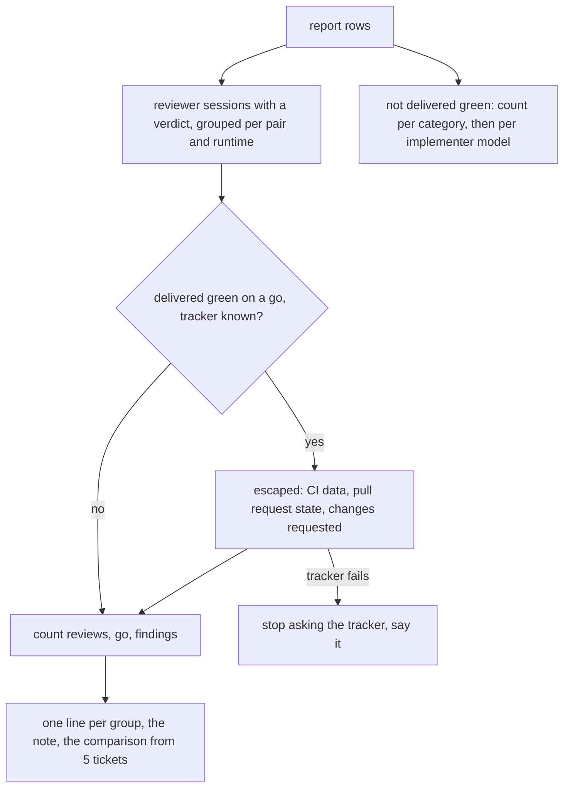
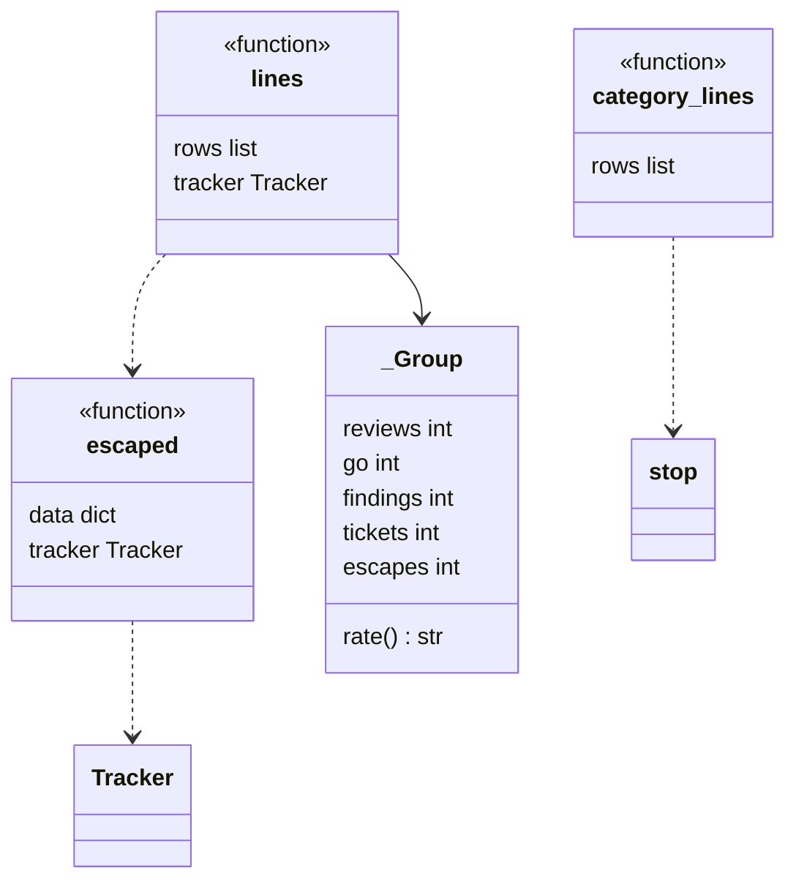
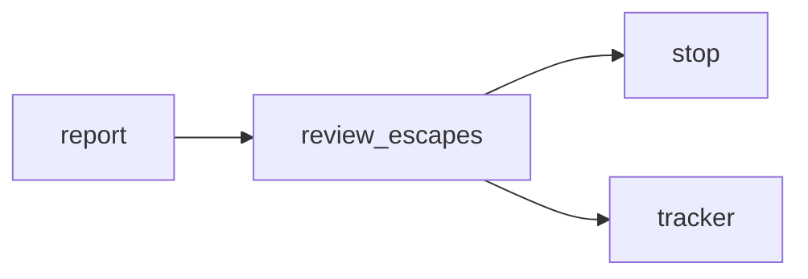

# Module `ariane.review_escapes`

Review escapes per model pair and stopped tickets per category, for `ariane report` (C10, C19, ADR 0058): how often a `go` was wrong, and why tickets did not end delivered green.

## Public API

| Name | Kind | What it does |
| --- | --- | --- |
| `MIN_TICKETS` | constant | 5: no escape rate is shown, nor compared, over fewer tickets. |
| `BY_HAND` | constant | `by hand`, the implementer of a hand takeover record (`ariane verify`), which has no implementer session. |
| `NO_CI` | constant | The line said when no reviewed ticket carries CI data (`ci_failures`): the CI part is skipped. |
| `NO_TRACKER` | constant | The line said when there is no tracker, or it failed: no escape is counted. |
| `implementer_model(data)` | function | The model of a ticket's first implementer session; `by hand` for a hand takeover, `unknown` otherwise. |
| `escaped(data, tracker)` | function | Whether the `go` that delivered a ticket was wrong: a red CI on the reviewed head (`ci_failures` in its metrics, not empty), or after the `go` (its reviewer session's `at`, else the record's `started` for a record from before `at`), the pull request closed without merge or a human "changes requested" review (`Tracker.changes_requested(number, since)`). The pull request is the branch's latest (one per ticket branch). None when the branch has no pull request; `TrackerError` when the tracker fails. |
| `lines(rows, tracker)` | function | The review escape lines of the report. |
| `category_lines(rows)` | function | The stop category lines of the report. |

## Behaviour and errors

- A review is a reviewer session that recorded its `verdict` and `findings` (`Metrics.reviewed`); older records without them are not counted. Reviews are grouped by implementer model, reviewer model and reviewer runtime; each line gives the reviews and the tickets they cover, the `go` verdicts, the findings per review, the escapes and the escape rate.
- An escape is counted on a record delivered green on a `go` (its last review): not a shadow ticket, outcome `delivered`, no `category`. The tracker is read at report time, the pull request of `ariane/<n>`, or of the branch of a hand takeover; a record whose branch has no pull request is left out. An open pull request with green or no CI is not an escape (yet). The escape rate is escapes over those `go` tickets, counted per distinct ticket number (several records of one ticket, such as hand takeovers, count once, escaped if any of them escaped), shown only from `MIN_TICKETS` distinct tickets; below, the line says how many tickets there are.
- Without CI data on any counted ticket, the `NO_CI` line says that the CI part was skipped. Without a tracker, or after its first failure (it is not asked again for the next tickets), the `NO_TRACKER` line replaces it and nothing more is counted. Nothing is posted.
- When two groups or more show a rate, "Escape rates compared:" lists them side by side, each with its number of tickets.
- `category_lines`: the tickets whose outcome is neither `delivered` nor `running`, or that have a `category` (a delivered draft or a red verification), counted per category in the order of `stop.CATEGORIES` (`not recorded` for a record from before categories), then the same per implementer model.

## Workflow

## Code view (C4 level 4)

## Collaborations

Arrows go from the importing module to the imported module; a dashed arrow is an import for type checking only.

<!-- generated: collaborations -->

<!-- end generated -->

## Serves

C10, C19; ADR 0058. See [the component view](../3-components.md).
