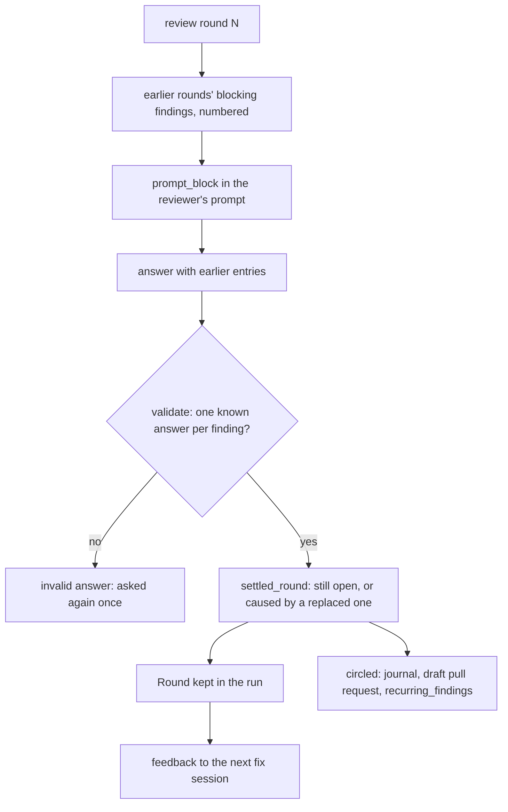
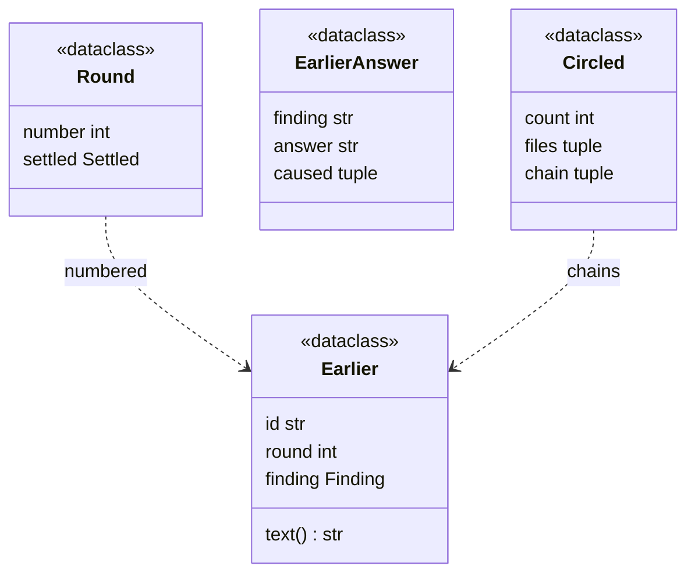
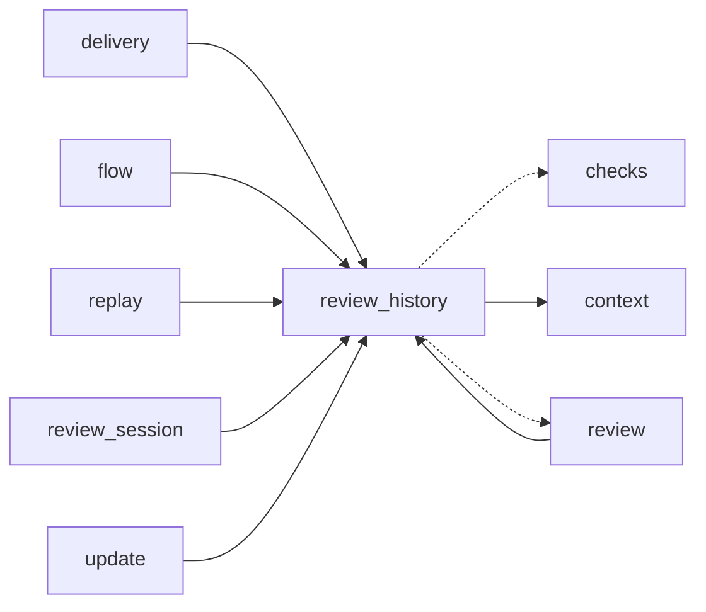

# Module `ariane.review_history`

The history of a ticket's review rounds (C10, C19, ADR 0059): the earlier rounds' blocking findings given to the next fix session and reviewer, the reviewer's answer for each in the `earlier` array, and the recurring findings the draft pull request and the metrics report.

## Public API

| Name | Kind | What it does |
| --- | --- | --- |
| `FIXED` | constant | `fixed`: the earlier finding is fixed in this commit. |
| `STILL_OPEN` | constant | `still open`: the earlier finding is still there. |
| `REPLACED` | constant | `replaced`: fixed, but the fix caused a new blocking finding. |
| `ANSWERS` | constant | The three answers, in that order. |
| `SCHEMA` | constant | The JSON Schema of the answer's `earlier` array, part of `review.SCHEMA`. |
| `EarlierAnswer` | dataclass | One entry of `earlier`: `finding` (the identifier), `answer`, `caused` (indexes in `findings`, for `replaced`). |
| `Round` | dataclass | A reviewed round: `number` and its `settled` review. |
| `Earlier` | dataclass | A blocking finding of a reviewed round: `id` (`<round>.<n>`), `round`, `finding`; `text()` gives `round R (`file:line`): title`. |
| `Circled` | dataclass | The last review's recurring findings: `count`, `files`, `chain` (one line per finding, oldest round first). |
| `earlier(rounds)` | function | The blocking findings of every round, in round order, with their identifiers. |
| `validate(data, listed)` | function | The errors of an answer's `earlier` array against the `listed` identifiers; used by `review.validate`. |
| `parse(data)` | function | The `earlier` array of a valid answer as `EarlierAnswer`s; empty when missing. |
| `prompt_block(listed)` | function | What the reviewer's prompt adds from round 1: the listed findings in a `kind="earlier-findings"` block and how to answer them; empty on round 0. |
| `feedback(rounds, settled, failed)` | function | What a fix session is told: the blocking findings of the rounds before the last review (round, file, title), then the last review's findings in full and the failed blocking checks. |
| `settled_round(rounds, number, settled)` | function | `settled` with its `circled` recurring findings, if any. |
| `circled_note(circled)` | function | The draft pull request's paragraph above the review table. |
| `record_lines(settled)` | function | What `review-<round>.md` adds: the answer for each earlier finding, then the chains. |

## Behaviour and errors

- Identifiers: the blocking findings of a round's settled findings (the reviewer's, then the unmet definition-of-done items) are numbered from 1 in order, `0.1`, `0.2`, then `1.1` for round 1.
- `validate`: without listed findings (round 0) `earlier` may be missing; otherwise it is required. Each entry is an object with `finding` and `answer` and no other key than `caused`; the identifier is a listed one, answered once; the answer is one of `ANSWERS`; `caused` is an array of integers, required and not empty for `replaced`, refused for another answer, each an index of a blocking finding of the answer. A listed identifier without an entry is an error. The errors make the answer invalid: the reviewer is asked again once (`review_session`).
- `feedback`: without earlier rounds it is the last review's findings alone (as before ADR 0059), `(no finding)` when there is nothing. The text comes from the reviewer: the caller (`context.implementer_prompt`) shows it in an untrusted block.
- `settled_round`: a recurring finding is an earlier finding the last answer marks `still open`, or a finding of the last answer that a `replaced` entry names in `caused`. Its chain follows the `replaced` answers of every round (each finding's first parent) back to the oldest finding, a `still open` one ending with "still open in round N". Without recurring findings `settled` is returned unchanged (`circled` is `None`).

## Workflow

## Code view (C4 level 4)

## Collaborations

Arrows go from the importing module to the imported module; a dashed arrow is an import for type checking only.

<!-- generated: collaborations -->

<!-- end generated -->

## Serves

C10, C19; ADR 0059. See [the component view](../3-components.md).
