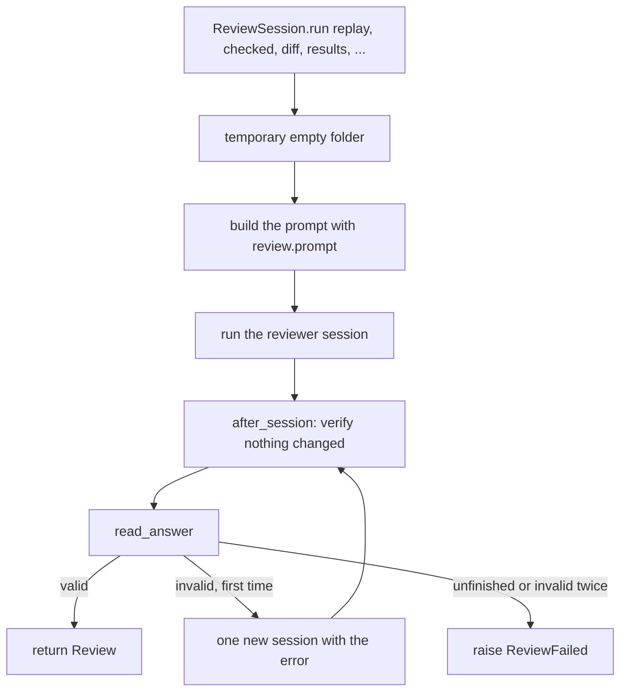
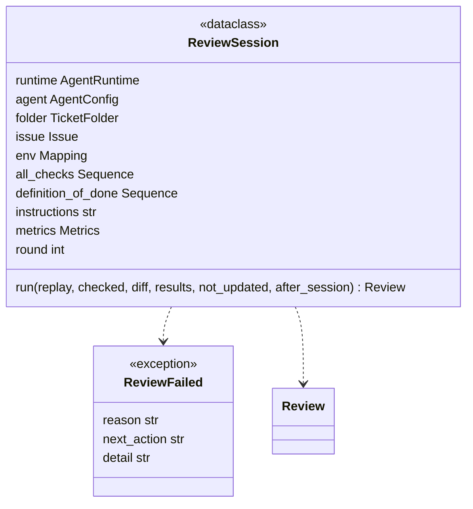
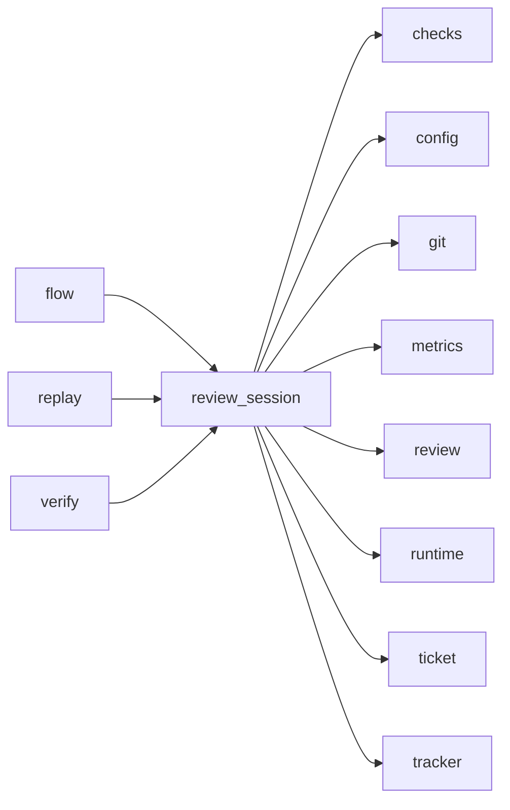

# Module `ariane.review_session`

The reviewer sessions of one review round (C10): a fresh read-only session on the reviewer tree (the commit without `CLAUDE.md`, `CLAUDE.local.md`, `AGENTS.md` and `.claude/`, ADR 0031), and one new session if its answer is invalid.

## Public API

| Name | Kind | What it does |
| --- | --- | --- |
| `ReviewFailed` | exception | No valid answer; carries `reason`, `next_action` and `detail`. |
| `read_answer(result)` | function | The validated answer of a session result, or the reason it is not one. |
| `ReviewSession` | dataclass | What the reviewer sessions of a ticket share; `run` returns the validated `Review`. |
| `cap_text(agent)` | function | Words the caps that apply, for the journal. |
| `instruction_dirs(tree)` | function | The folders whose instruction files, with their ancestors', a reviewer on `tree` can load: the system temporary folder and the tree's parent (ADR 0031). |

## Behaviour and errors

- `ReviewSession`: what the reviewer sessions of a ticket share; `run` returns the validated answer and calls back to verify that the session changed nothing.
- A Claude Code reviewer runs from a temporary empty folder and reads the tree through `Session.add_dirs`; opencode runs in the tree. `instructions` is the base branch's `CLAUDE.md`, passed to the prompt as data.
- Before its sessions, `run` journals `ticket.review.instructions`: how many places `git.instruction_snapshot` checked for `instruction_dirs(tree)` and the reviewer's runtime, and the digest of each file present. The flow's guard holds the same snapshot from before the implementer's session, so a file written there by an agent, a check or a setup stops the ticket before the review (ADR 0031).
- `run` takes `name_status` (the untruncated changed-file list) and passes it to `review.prompt`.
- Its `env` is built by the caller from the reviewer runtime's own login variables only.
- The journal line of a reviewer session starts with the reviewer's runtime as `runtime.describe` words it (for opencode: its version and that the title call's usage is not reported).
- `cap_text` words the caps that apply for the journal: for opencode "runtime cost cap none; Ariane stops at … USD of reported cost or … tokens".
- A reviewer session stopped at a cap: the `ticket.review.stopped` entry starts with "Cap reached: <cap>."; `ReviewFailed` says "the reviewer session stopped at <cap>" and its next action names `agents.reviewer.max_tokens` or `agents.reviewer.max_budget_usd` (#139). Other stop reasons keep "the reviewer session stopped: <reason>".
- A `quota` stop ends the ticket with "reviewer quota reached" and the result's next step ("restart the ticket after <time>"), never a no-go; a result with a `next_step` (Codex not logged in) stops with its summary and that step (ADR 0043). `cap_text` for Codex says the cost is billed by the plan or the API key.
- Each reviewer session is run through `Metrics.run_session` when `metrics` is given (C19), with its review `round`.
- `read_answer`: the validated answer of a session result, or the reason it is not one.
- `ReviewFailed`: no valid answer (the session did not finish, or two invalid answers); the flow turns it into a stop with status `needs a human`.

## Workflow

## Code view (C4 level 4)

## Collaborations

Arrows go from the importing module to the imported module; a dashed arrow is an import for type checking only.

<!-- generated: collaborations -->

<!-- end generated -->

## Serves

C10; ADR 0016, ADR 0025, ADR 0027. See [the component view](../3-components.md).
