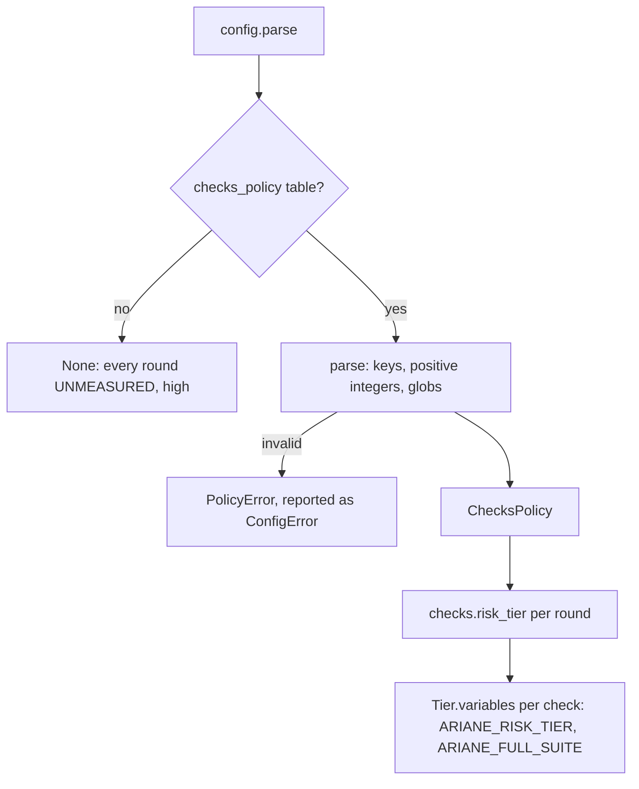
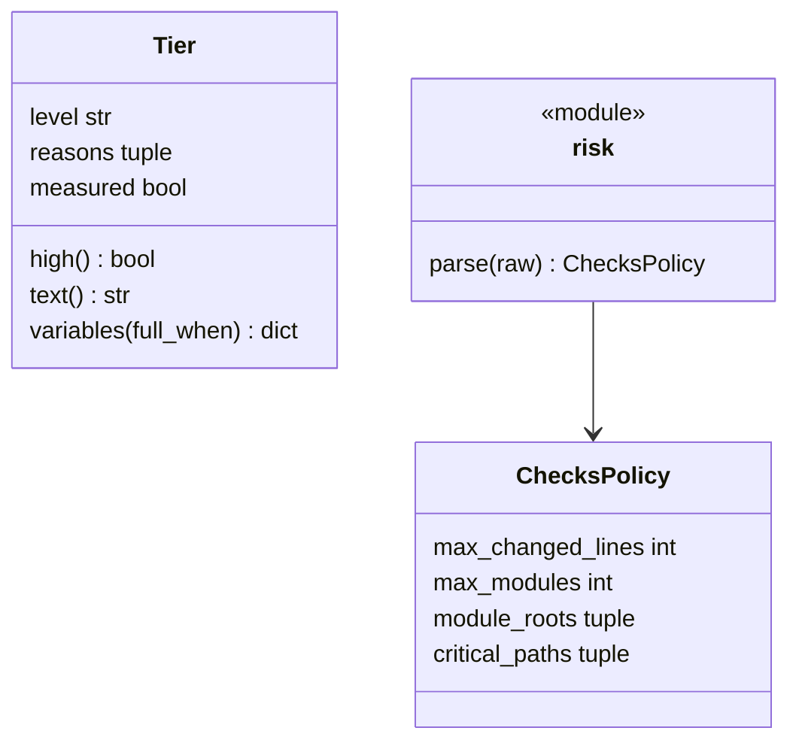
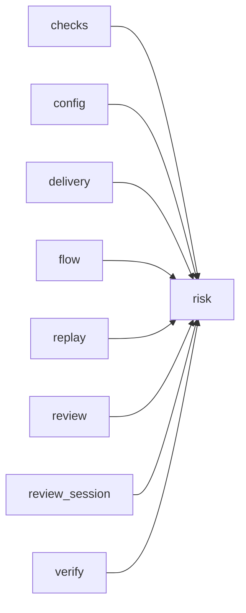

# Module `ariane.risk`

The risk tier of a round (C9, ADR 0056): the optional `[checks_policy]` table, which says what makes a round `high`, and the `Tier` record that `checks.risk_tier` computes from the round's diff and gives to every check as `ARIANE_RISK_TIER` and `ARIANE_FULL_SUITE`.

## Public API

| Name | Kind | What it does |
| --- | --- | --- |
| `TIER_VARIABLE` | constant | `"ARIANE_RISK_TIER"`, the variable holding the tier (`low` or `high`) in every check's environment. |
| `FULL_SUITE_VARIABLE` | constant | `"ARIANE_FULL_SUITE"`, `1` when the check should run its full suite, else `0`. |
| `LOW` | constant | `"low"`, the tier of a round no rule makes high. |
| `HIGH` | constant | `"high"`, the tier of a round at least one rule makes high, and of every round without `[checks_policy]`. |
| `FULL_WHEN` | constant | The values of `checks[].full_when`: `"high"` (the default) and `"always"`. |
| `NO_POLICY` | constant | The reason of the tier without `[checks_policy]`: "no `[checks_policy]`". |
| `DEFAULT_MAX_CHANGED_LINES` | constant | `300`, `max_changed_lines` when not given. |
| `DEFAULT_MAX_MODULES` | constant | `3`, `max_modules` when not given. |
| `PolicyError` | exception | The `[checks_policy]` table is invalid; `config` reports it as a `ConfigError` naming the key. |
| `ChecksPolicy` | dataclass | `[checks_policy]`: `max_changed_lines`, `max_modules`, `module_roots` (globs of the folders whose children count as modules; empty: the repository root), `critical_paths` (globs). |
| `Tier` | dataclass | A round's `level` (`low` or `high`), its `reasons`, and `measured` (False without `[checks_policy]`); `high`, `text()` ("high: 412 changed lines (more than 300); touches `critical_paths` `src/auth/**`") and `variables(full_when)`, the two variables of a check. |
| `UNMEASURED` | constant | The tier without `[checks_policy]`: `high`, reason `NO_POLICY`, not `measured`. |
| `parse(raw)` | function | The `[checks_policy]` table as a `ChecksPolicy`, or `None` when it is absent. |

## Behaviour and errors

- `parse` refuses a value that is not a table (`checks_policy`), an unknown key (`checks_policy.<key>: unknown key`), a `max_changed_lines` or `max_modules` that is not a positive integer (0, a negative number, a fraction, a boolean, a string), and a `module_roots` or `critical_paths` that is not a non-empty list of non-empty strings, each naming `checks_policy.<key>`.
- `Tier.variables(full_when)` gives `ARIANE_RISK_TIER` the tier and `ARIANE_FULL_SUITE` `1` when the tier is `high` or `full_when` is `"always"`, else `0`. Without `[checks_policy]` the tier is always `high`, so every check gets `ARIANE_FULL_SUITE=1`: no behaviour change.
- A tier that is not `measured` does not change the review's sizing (ADR 0046); a measured `high` keeps the full review (`review_session.ReviewSession.small`).

## Workflow

## Code view (C4 level 4)

## Collaborations

Arrows go from the importing module to the imported module; a dashed arrow is an import for type checking only.

<!-- generated: collaborations -->

<!-- end generated -->

## Serves

C9; ADR 0056. See [the component view](../3-components.md).
