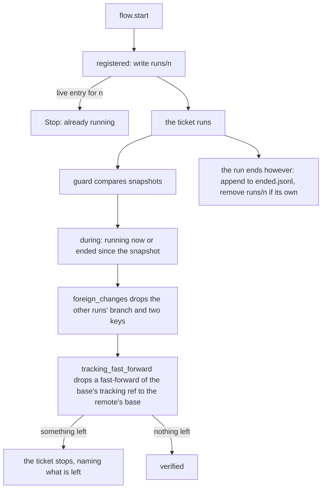
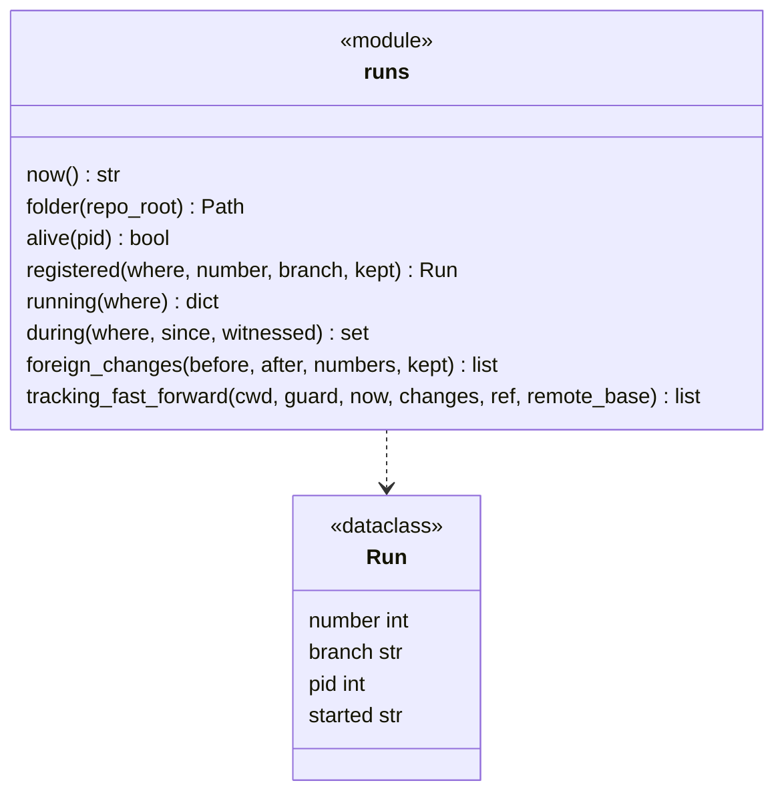
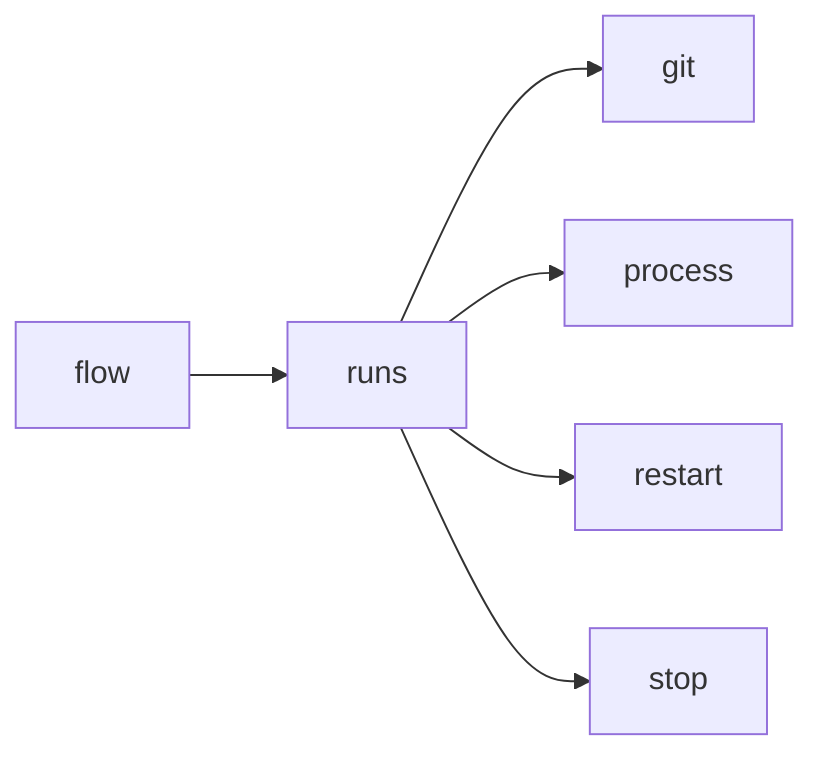

# Module `ariane.runs`

The run registry: which tickets Ariane runs on a repository, so that several tickets can run at once and the push guard tells another run's own branch bookkeeping from an agent's change to git (C11, ADR 0017).

## Public API

| Name | Kind | What it does |
| --- | --- | --- |
| `FOLDER` | constant | The registry's folder name, `runs`, under `<repo>.ariane/`. |
| `LOCK` | constant | `.lock`: the file whose OS lock serializes every read and write of the registry. |
| `ENDED` | constant | `ended.jsonl`: one line per run that ended (number, branch, process id, start and end). |
| `REMOTE` | constant | The remote another run's `branch.ariane/<m>.remote` key names, `origin`. |
| `Run` | dataclass | A registry entry: `number`, `branch`, `pid`, `started` (ISO 8601, UTC), `kept` (with `--restart`, the name its previous branch is kept under, else empty). |
| `now()` | function | The current time as the registry writes it (ISO 8601, UTC, microseconds). |
| `folder(repo_root)` | function | `<repo>.ariane/runs`, next to the tickets' working trees. |
| `alive(pid)` | function | Whether a process exists: signal 0 on POSIX, an open handle and `STILL_ACTIVE` on Windows. |
| `registered(where, number, branch, kept="")` | function | A context manager: records the run in `where/<n>` for the time of the block, then appends it to `ended.jsonl` and removes the entry if it is still its own, however the block ends. |
| `WATCH_SECONDS` | constant | How often `watching` reads the registry (0.2 s). |
| `running(where)` | function | The registered runs whose process exists, by ticket number; stale entries are reclaimed (their end published, then removed). |
| `genuine(run)` | function | Whether a live entry is an Ariane run: its process exists, is not a descendant of this one, and on Linux runs `start <n>`. |
| `watching(where)` | function | A context manager: a thread of this process reads the registry every `WATCH_SECONDS` and returns the dict of the genuine runs it saw live (`witnessed`). |
| `during(where, since, witnessed)` | function | The genuine live runs (added to `witnessed` when not already there with the same process: an entry is written once, so a rewrite is not its run's), and the runs that ended at or after `since` that `witnessed` holds with the same process and start. |
| `kept_branches(witnessed, numbers)` | function | The `kept` of the witnessed runs in `numbers` that `restart.is_kept_name` accepts for their ticket and start; what the push guard passes as `kept`. |
| `foreign_changes(before, after, numbers, kept=())` | function | `git.snapshot_changes(before, after)` without the changes that are the own bookkeeping of a run in `numbers`, and the branches in `kept`. |
| `tracking_fast_forward(cwd, guard, now, changes, ref, remote_base)` | function | `changes` without the move of the base's tracking `ref` when it is the only change left and a fast-forward to the commit `remote_base()` returns; `guard` then takes the new commit (ADR 0055). |
| `guard_stop(after, changes, quiet)` | function | The `Stop` of a run whose guard found `changes` after `after` (instruction files first, then git), or None when there are none; `quiet` ends its next action. |
| `remote_stop(after, changed, quiet)` | function | The `Stop` of a run whose remote refs `changed` during `after`. |

## Behaviour and errors

- Every operation holds `where/.lock` (`fcntl.flock` on POSIX, `msvcrt.locking` on Windows; the system frees it when the process dies): registering (check, reclaim a stale entry, link), ending a run, `running` and `during`. Two starters reclaiming one stale entry admit one run; a reader cleaning a stale entry never deletes a run registered meanwhile.
- `registered` writes the entry whole, then links it to `where/<n>`: a live entry for the same ticket raises `Stop` ("ticket #n is already running (process p)"); a stale one (dead process, or unreadable) is replaced. At the end it appends the run to `ended.jsonl` first, then removes the entry only if it is still this run's: a reader always finds the run in one or the other, and a run never removes another's entry. `flow.start` enters it before the ticket's branch exists and leaves it after the outcome, so a stop, Ctrl-C or an exception removes the entry too.
- `running` and `during` reclaim an entry whose process no longer exists: its end is appended to `ended.jsonl`, then it is deleted (if the end cannot be written it stays). If a run cannot publish its own end, its entry stays too. The entries and `ended.jsonl` are files an agent can write: `during` counts a live entry only if `genuine`, and an ended run only if this run saw it live (`witnessed`, filled by `watching` for the whole run), so a run that started and ended within another run's session is known to that run's guard, and a forged line is not.
- `foreign_changes` tolerates, for each ticket `m` in `numbers`, and nothing more: the local branch `refs/heads/ariane/<m>` created, moved or deleted; each branch named in `kept` (the caller passes `kept_branches`: the `kept` of the runs in `numbers` it witnessed, validated by `restart.is_kept_name` because the entry is agent-writable, registered before a restart renames `ariane/<m>` to it, ADR 0047); in the shared `config`, the entries `branch.ariane/<m>.remote=origin` and `branch.ariane/<m>.merge=refs/heads/ariane/<m>` added or removed (Ariane's own preparation writes no key: `worktree add --no-track`). The shared config is compared by key: the snapshot's `keys <path>` part is the file's text, listed by `git.config_keys` (`git config --file - --list --null`) only when the two texts differ (ADR 0053), as counted entries and in order; when they differ but list the same entries (a comment), the `keys` part is dropped and the file's digest change is kept. Its digest and `keys` changes are dropped only when every entry that moved is one of those and every other entry is still there in the same order (swapping two values of a repeated key changes its effect); a change of the file that moves no key (a comment) is kept. Its `setting local` lines (origin that same file) whose entry is one of those are always dropped: the `keys` part decides for that file, and its setting lines are read separately, possibly before or after another run's write. Any other change, another key of that section (`pushRemote`), a hook, another branch, another scope, is kept and stops the ticket.
- `tracking_fast_forward` (C11, ADR 0055) acts only when the one change left is `changed: ref <ref>` (the base's tracking ref): it drops it when the new commit descends from the guard's (`git.is_ancestor`) and is the commit the remote's base branch points to now (`remote_base`, called only then, after the rest of git was found unchanged), and writes the new commit into `guard`, so a later move is measured from it. A move backwards, sideways, to a commit that is not the remote's base, or a deletion is kept: the guard stops with the same reason as before.

## Workflow

## Code view (C4 level 4)

## Collaborations

Arrows go from the importing module to the imported module; a dashed arrow is an import for type checking only.

<!-- generated: collaborations -->

<!-- end generated -->

## Serves

C11, C23; ADR 0017, ADR 0053. See [the component view](../3-components.md).
