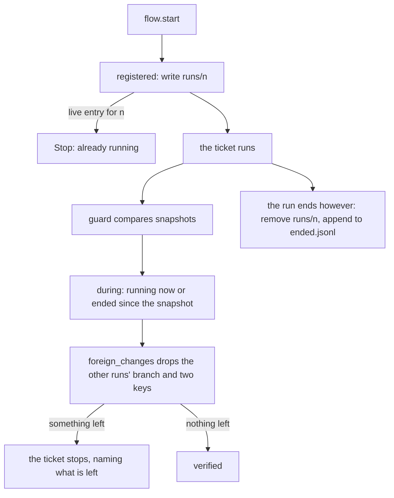
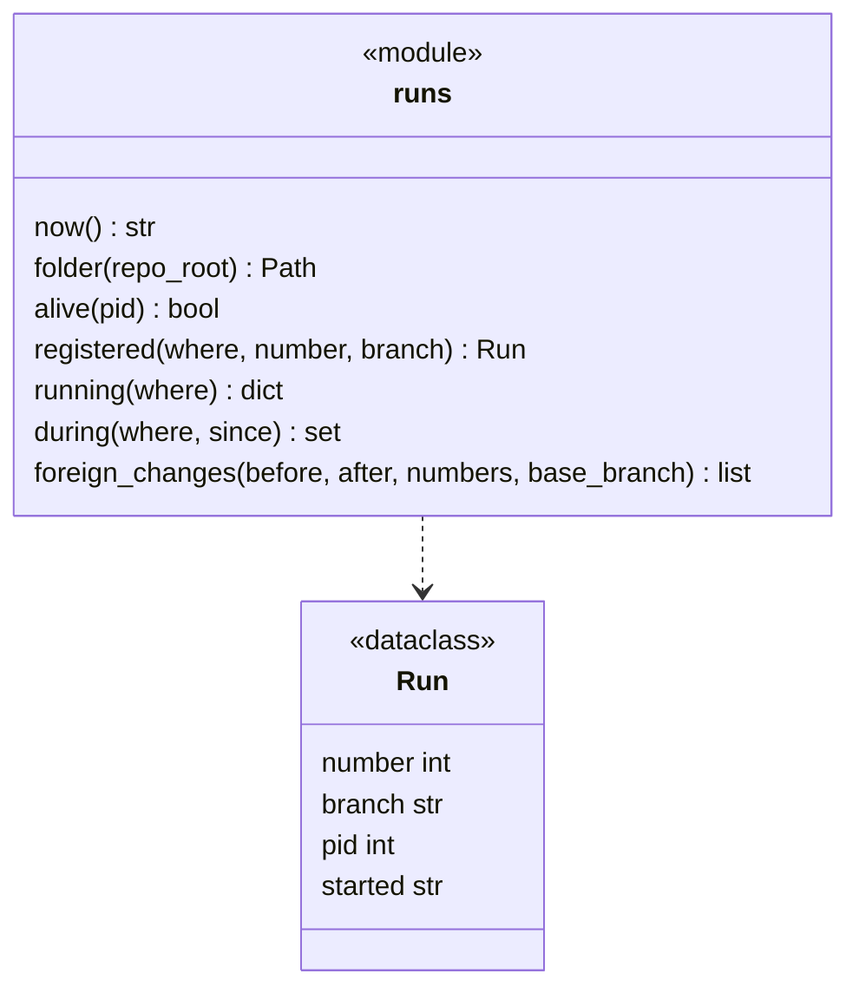
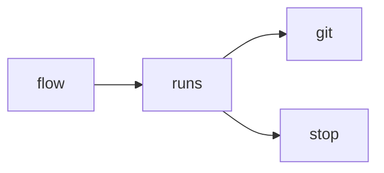

# Module `ariane.runs`

The run registry: which tickets Ariane runs on a repository, so that several tickets can run at once and the push guard tells another run's own branch bookkeeping from an agent's change to git (C11, ADR 0017).

## Public API

| Name | Kind | What it does |
| --- | --- | --- |
| `FOLDER` | constant | The registry's folder name, `runs`, under `<repo>.ariane/`. |
| `ENDED` | constant | `ended.jsonl`: one line per run that ended (number, branch, process id, start and end). |
| `REMOTE` | constant | The remote another run's `branch.ariane/<m>.remote` key names, `origin`. |
| `Run` | dataclass | A registry entry: `number`, `branch`, `pid`, `started` (ISO 8601, UTC). |
| `now()` | function | The current time as the registry writes it (ISO 8601, UTC, microseconds). |
| `folder(repo_root)` | function | `<repo>.ariane/runs`, next to the tickets' working trees. |
| `alive(pid)` | function | Whether a process exists: signal 0 on POSIX, an open handle and `STILL_ACTIVE` on Windows. |
| `registered(where, number, branch)` | function | A context manager: records the run in `where/<n>` for the time of the block, then removes it and appends it to `ended.jsonl`, however the block ends. |
| `running(where)` | function | The registered runs whose process exists, by ticket number; stale entries are removed. |
| `during(where, since)` | function | The tickets registered now, or that ended at or after `since`. |
| `foreign_changes(before, after, numbers, base_branch)` | function | `git.snapshot_changes(before, after)` without the changes that are the own bookkeeping of a run in `numbers`. |

## Behaviour and errors

- `registered` writes the entry whole, then links it to `where/<n>` (`os.link`, which never replaces a file): a live entry for the same ticket raises `Stop` ("ticket #n is already running (process p)"); a stale one (dead process, or unreadable) is replaced. `flow.start` enters it before the ticket's branch exists and leaves it after the outcome, so a stop, Ctrl-C or an exception removes the entry too.
- `running` and `during` ignore and delete an entry whose process no longer exists. `ended.jsonl` makes a run that started and ended within another run's session known to that run's guard.
- `foreign_changes` tolerates, for each ticket `m` in `numbers`, and nothing more: the local branch `refs/heads/ariane/<m>` created, moved or deleted; in the shared `config`, the entries `branch.ariane/<m>.remote=origin` and `branch.ariane/<m>.merge=refs/heads/ariane/<m>` or `=refs/heads/<base>` (what `git worktree add -b` writes) added or removed. The shared config is compared by key: the snapshot's `keys <path>` part (`git config --file <path> --list --null`), as counted entries. Its digest change and its `setting local` lines (origin that same file) are dropped only when every entry that moved is one of those; a change of the file that moves no key (a comment) is kept. Any other change, another key of that section (`pushRemote`), a hook, another branch, another scope, is kept and stops the ticket.

## Workflow

## Code view (C4 level 4)

## Collaborations

Arrows go from the importing module to the imported module; a dashed arrow is an import for type checking only.

<!-- generated: collaborations -->

<!-- end generated -->

## Serves

C11, C23; ADR 0017. See [the component view](../3-components.md).
