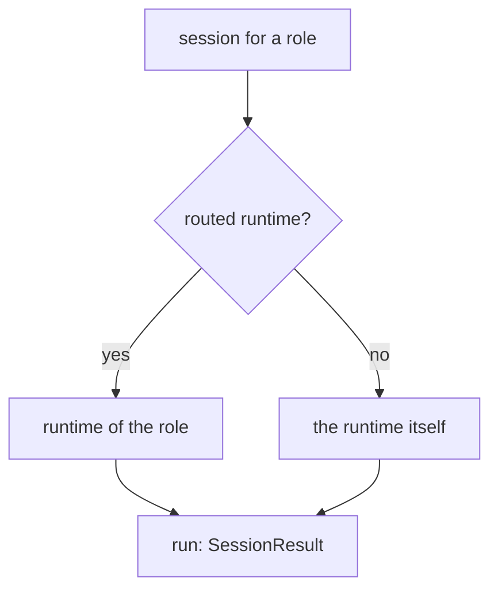
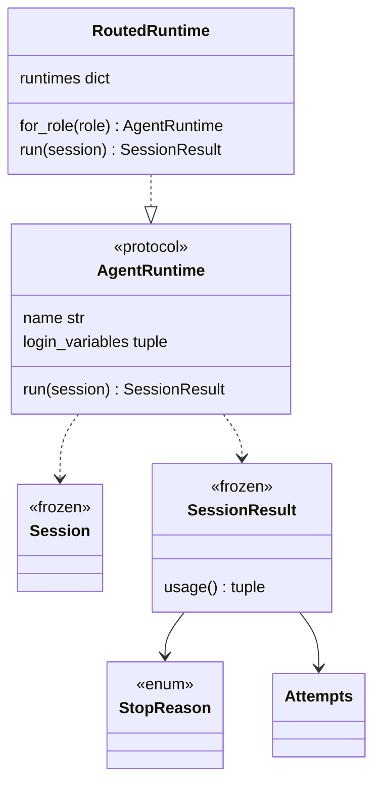
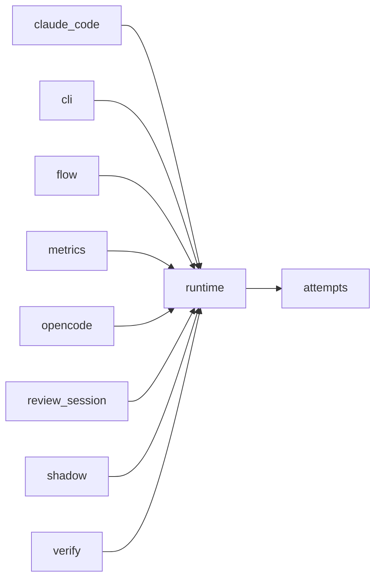

# Module `ariane.runtime`

The agent runtime interface (C5): one fresh session per stage, whatever the agent CLI. Claude Code implements it, and opencode for the reviewer role.

## Public API

| Name | Kind | What it does |
| --- | --- | --- |
| `StopReason` | enum | Why a session ended: `finished`, `budget`, `turns`, `timeout`, `error`. |
| `Session` | class | What to run: role, model, tools, cost cap `max_budget_usd`, Ariane's optional token cap `max_tokens`, timeout, `cwd`, prompt, complete `env`, optional `json_schema`, and `add_dirs`, the extra trees the agent may read (the reviewer's cwd is an empty folder and its tree is listed here, ADR 0031). |
| `SessionResult` | class | What came back: stop reason, cost, tokens, summary, permission denials, `cap` (which cap stopped a `budget` session), `structured_output` and `attempts` (pushes and pull requests attempted, C19, ADR 0036); `usage()` words cost and tokens for the journal. |
| `AgentRuntime` | protocol | `name`, `login_variables` (exact names and prefixes ending in `_` of the variables kept in the agent's environment for its login, ADR 0024) and `run(session)`. |
| `RoutedRuntime` | class | `RoutedRuntime(runtimes)`: one runtime per role (`[agents.<role>] runtime`, ADR 0029); `for_role(role)` and `run(session)` go to the runtime of the session's role. It has no login variables of its own. |
| `for_role(runtime, role)` | function | The runtime that serves `role` (the runtime itself unless it routes by role). |
| `describe(runtime)` | function | The runtime as the journal words it: its name, plus its own description (the version) when it has one. |

## Behaviour and errors

- Reads and writes no file and raises nothing of its own, except `KeyError` from `RoutedRuntime` for a role without a runtime.
- Each session's environment is built from `for_role(role).login_variables`.

## Workflow

## Code view (C4 level 4)

## Collaborations

Arrows go from the importing module to the imported module; a dashed arrow is an import for type checking only.

<!-- generated: collaborations -->

<!-- end generated -->

## Serves

C5; ADR 0007, ADR 0014, ADR 0015, ADR 0024, ADR 0029, ADR 0031, ADR 0036. See [the component view](../3-components.md).
