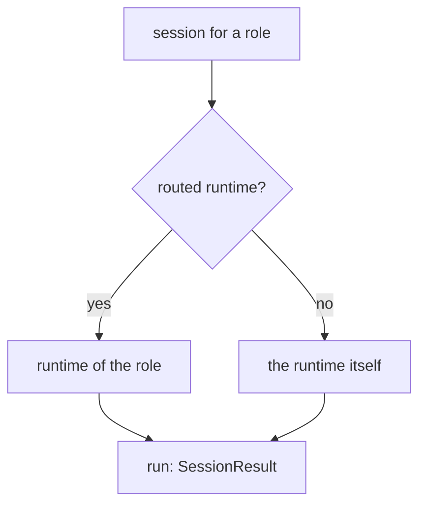
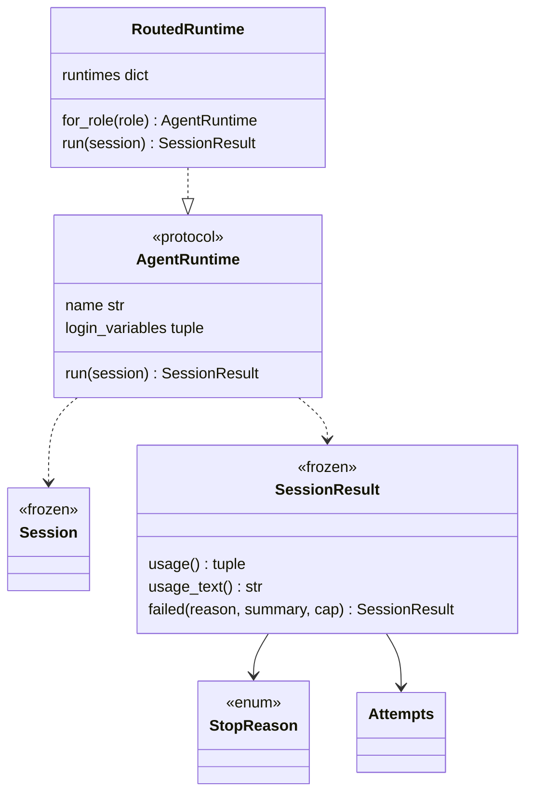
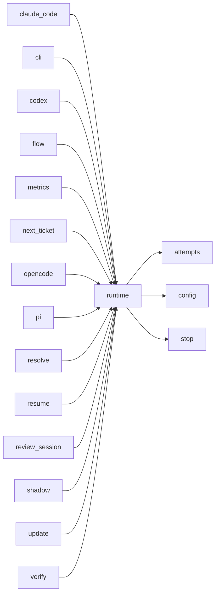

# Module `ariane.runtime`

The agent runtime interface (C5): one fresh session per stage, whatever the agent CLI. Claude Code implements it, and opencode, Codex and pi for the reviewer role.

## Public API

| Name | Kind | What it does |
| --- | --- | --- |
| `StopReason` | enum | Why a session ended: `finished`, `budget`, `turns`, `timeout`, `quota` (a subscription's usage limit is reached, ADR 0043), `error`. |
| `Session` | class | What to run: role, model, tools, cost cap `max_budget_usd`, Ariane's optional token cap `max_tokens`, timeout, `idle_timeout_s` (no event for that long stops the session; `None` for no idle limit, ADR 0045), `max_turns` (the turn limit; `None`: the runtime's own, ADR 0062), `cwd`, prompt, complete `env`, optional `json_schema`, and `add_dirs`, the extra trees the agent may read (the reviewer's cwd is an empty folder and its tree is listed here, ADR 0031). |
| `SessionResult` | class | What came back: stop reason, cost, tokens, summary, permission denials, `cap` (which cap stopped a `budget` session), `structured_output` and `attempts` (pushes and pull requests attempted, C19, ADR 0036); `usage()` words cost and tokens for the journal; `usage_text()` is the journal line with the cap, cost and tokens; `stop_category()` is `category(stop_reason)` (ADR 0058); `stop_text()` is the stop reason for a stop line, with the summary in parentheses for a `timeout` (which limit, ADR 0045); `billing` (`plan`, `api` or none) `next_step` (what to do, for a quota or a login stop) and `reset_at` (a quota stop: when the runtime said it resets, UTC, ADR 0062), `turns` (the turns the session took, when reported); `with_next(step)` returns a copy with a next step; `SessionResult.failed(reason, summary, cap=None)` builds a result with no usage. |
| `AgentRuntime` | protocol | `name`, `login_variables` (exact names and prefixes ending in `_` of the variables kept in the agent's environment for its login, ADR 0024) and `run(session)`. |
| `RoutedRuntime` | class | `RoutedRuntime(runtimes)`: one runtime per role (`[agents.<role>] runtime`, ADR 0029); `for_role(role)` and `run(session)` go to the runtime of the session's role. It has no login variables of its own. |
| `category(reason)` | function | The stop category (`stop.CATEGORIES`, ADR 0058) of a session that did not finish: `budget` for `budget`, `turns` and `timeout`, else `runtime` (an error, a quota). |
| `for_role(runtime, role)` | function | The runtime that serves `role` (the runtime itself unless it routes by role). |
| `describe(runtime)` | function | The runtime as the journal words it: its name, plus its own description (the version) when it has one. |
| `token_cap(n)` | function | The `SessionResult.cap` text of Ariane's token cap. |
| `cost_cap(usd)` | function | The `SessionResult.cap` text of the runtime's cost cap. |
| `is_token_cap(cap)` | function | Whether a cap text is the token cap's. |
| `timeout_summary(seconds)` | function | The summary of a session killed at its time limit. |
| `idle_summary(seconds, stdout)` | function | The summary of a session killed at its idle limit: "no activity for <m> min (idle limit); last event: <`last_event(stdout)`>" (ADR 0045). |
| `last_event(stdout)` | function | The last line's event type, with "(tool <name>)" when it was a tool call (a Claude Code `tool_use` block, an opencode `tool_use` part's `tool`, a Codex item's type); "none" without a line, "not a JSON event" otherwise. |
| `OUTPUT_TAIL_CHARS` | constant | How much of a failed process's output goes into an error summary (2000). |
| `reset_moment(text, now=None)` | function | The UTC time, as ISO text, a runtime's "try again at/in <text>" names: an ISO time (without a zone, the machine's local time), a span ("2 hours 5 minutes") from `now`, or a clock time ("3:45 PM", the machine's local time) on the date the text names ("Oct 25", "Oct 25th, 2026"; without a year, the next such date from `now`'s day; a date without a clock time is the end of that day) or else at its next occurrence; None otherwise, and for an impossible date or time. A quota stop's `SessionResult.reset_at` (ADR 0062). |
| `json_object(line)` | function | The JSON object a line holds, or `None`. |
| `as_int(value)` | function | The value if it is an int, not a bool; else `None`. |
| `as_number(value)` | function | The value as a float if it is an int or float, not a bool; else `None`. |
| `login_for(runtime, role, model)` | function | The login variables of `role`'s sessions on `model`: the served runtime's `login_for(model)` when it has one (opencode, whose login depends on the model's provider), else its `login_variables`. |
| `session_for(agent, role, *, cwd, prompt, env, **extra)` | function | The `Session` of `role` from an `AgentConfig`; `extra` is `json_schema` or `add_dirs`; `idle_timeout_s` is `idle_minutes` in seconds, or `None`; `max_turns` is the agent's. |

## Behaviour and errors

- Reads and writes no file and raises nothing of its own, except `KeyError` from `RoutedRuntime` for a role without a runtime.
- Each session's environment is built from `login_for(runtime, role, model)` with the session's model (ADR 0046).

## Workflow

## Code view (C4 level 4)

## Collaborations

Arrows go from the importing module to the imported module; a dashed arrow is an import for type checking only.

<!-- generated: collaborations -->

<!-- end generated -->

## Serves

C5; ADR 0007, ADR 0014, ADR 0015, ADR 0024, ADR 0029, ADR 0031, ADR 0036, ADR 0058. See [the component view](../3-components.md).
