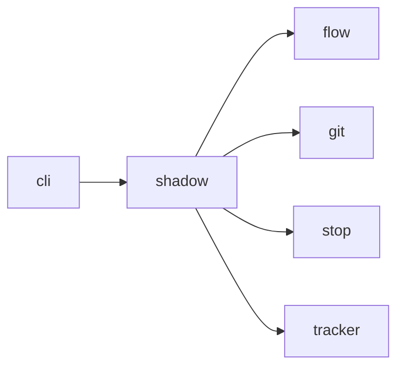

# Module `ariane.shadow`

`ariane start --shadow <issue>` (C19, C23, ADR 0036): the whole ticket flow in a separate clone, with no push, no pull request, no commit status and no comment.

## Main types and functions

- `start`: reads the issue, refuses an existing clone ("remove it to start over"), clones the user's repository with `git clone --local --no-checkout` into `<repo>.ariane/shadow/<n>/`, removes `origin`, checks out `ariane/<n>` at the user's last known `origin/<base branch>` and runs the flow. The user's `.git` is only read, and nothing is fetched.
- `ShadowRun`: the ticket run of [flow](flow.md) with metrics mode `shadow`, no remote check and a local delivery: the outcome (`delivered`, or `needs a human` when the review is still `no-go`) goes to the journal, `status.md` and `metrics.json`, committed in the clone. The final line is "Shadow ticket #<n> done (<outcome>, review <verdict>). Next: read <clone>/work/<n>/, then run ariane judge <n> accept|reject --minutes N."
- `clone_path`: where a shadow ticket lives.

## Collaborations

Arrows go from the caller to the callee.

## Serves

C19, C23; ADR 0030, ADR 0036. See [the component view](../3-components.md).
