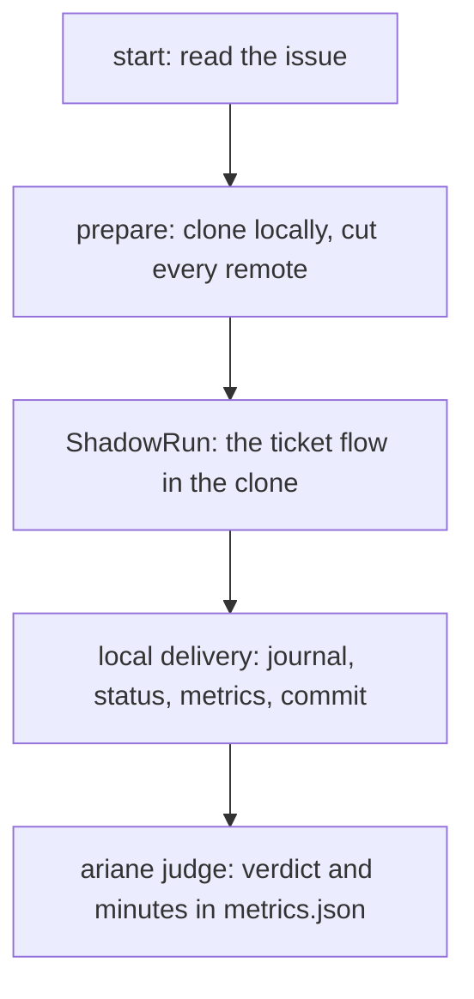
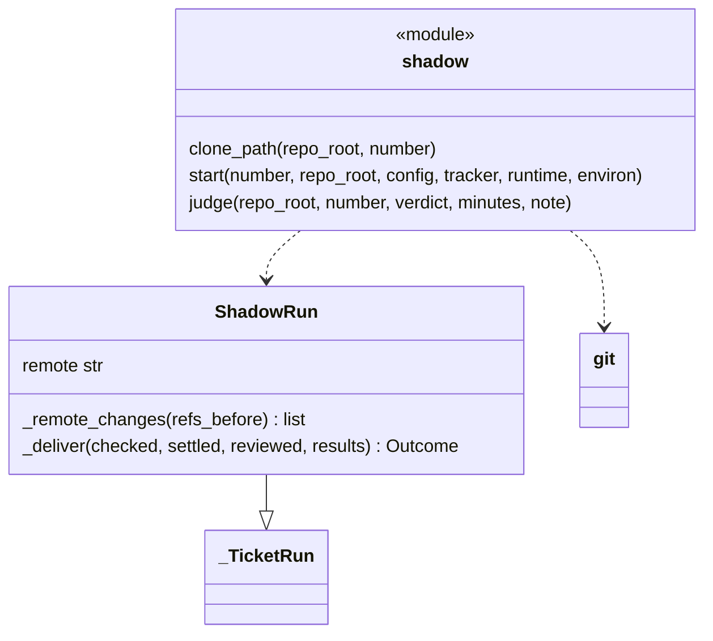
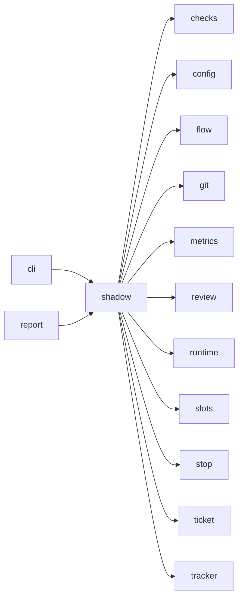

# Module `ariane.shadow`

`ariane start --shadow <issue>` (C19, C23, ADR 0036): the whole ticket flow in a separate clone, with no push, no pull request, no commit status and no comment.

## Public API

| Name | Kind | What it does |
| --- | --- | --- |
| `MAX_MINUTES` | constant | 1440: the most minutes a judgement may state. |
| `VERDICTS` | constant | `accept` and `reject`, the verdicts of `judge`. |
| `BASE_REF_REMOTE` | constant | `shadow`: only names the base branch's ref in the clone; it is not a remote. |
| `clone_path(repo_root, number)` | function | Where a shadow ticket lives: `<repo>.ariane/shadow/<n>/`. |
| `start(number, *, repo_root, config, tracker, runtime, environ)` | function | Runs a shadow ticket and returns its `Outcome`; it holds the run's machine-wide slot (`slots.held`, ADR 0050) from before the clone to its end, and refuses when all 16 are held. |
| `ShadowRun` | class | The ticket run of [flow](flow.md) with metrics mode `shadow`, no remote check and a local delivery; `restartable = False`, so its stops never name `--restart` (ADR 0047). |
| `judge(repo_root, number, verdict, minutes, note=None)` | function | Records the human's verdict and time in the shadow ticket's `metrics.json` (ADR 0037). |

## Behaviour and errors

- `start` reads the issue, refuses an existing clone ("remove it to start over") and an unknown `origin/<base branch>` in the user's repository, clones it with `git clone --local --no-checkout` into `<repo>.ariane/shadow/<n>/`, removes `origin`, checks out `ariane/<n>` at the user's last known `origin/<base branch>` and runs the flow. The user's `.git` is only read, and nothing is fetched. A tracker error or a stop before the start gives an `Outcome` with a next action.
- `ShadowRun` delivers locally: the outcome (`delivered`, or `needs a human` when the review is still `no-go`) goes to the journal, `status.md` and `metrics.json`, committed in the clone. The final line is "Shadow ticket #<n> done (<outcome>, review <verdict>). Next: read <clone>/work/<n>/, then run ariane judge <n> accept|reject --minutes N."
- `judge` (`ariane judge <n> accept|reject --minutes N [--note TEXT]`) writes `judgement` into the shadow ticket's `metrics.json` and keeps earlier ones in `judgements_before`; no clone or a `running` ticket gives one line and exit 1.

## Workflow

## Code view (C4 level 4)

## Collaborations

Arrows go from the importing module to the imported module; a dashed arrow is an import for type checking only.

<!-- generated: collaborations -->

<!-- end generated -->

## Serves

C19, C23; ADR 0030, ADR 0036, ADR 0037, ADR 0047. See [the component view](../3-components.md).
