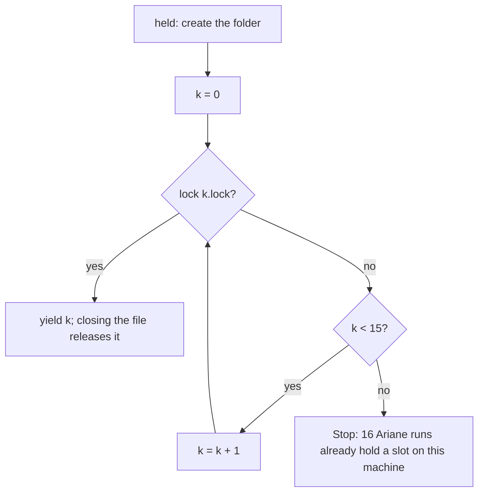
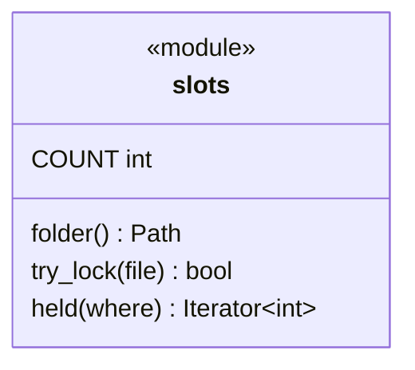
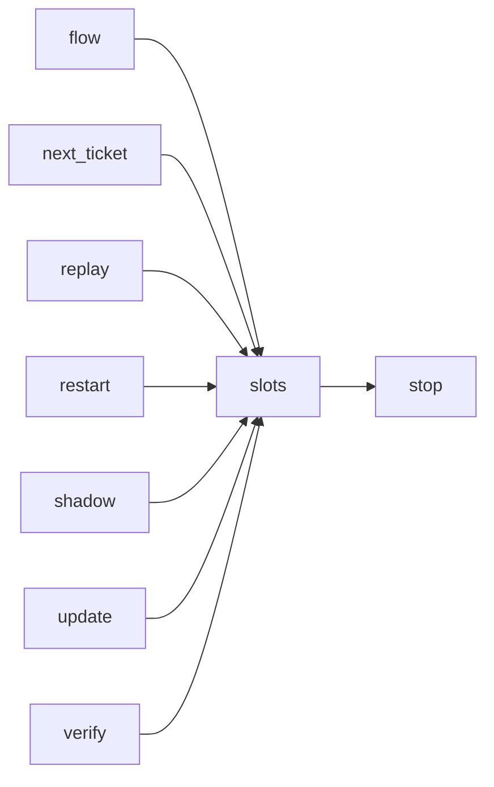

# Module `ariane.slots`

The machine-wide slot of a run (C11, C22, ADR 0050): a number from 0 to 15 that no other Ariane run on the machine holds at the same time, given to the project as `ARIANE_SLOT` so it can keep its ports and other local resources apart. It also holds the operating-system lock helper the ticket lock (`restart.locked`) uses.

## Public API

| Name | Kind | What it does |
| --- | --- | --- |
| `COUNT` | constant | `16`, the number of slots on a machine. |
| `REASON` | constant | "16 Ariane runs already hold a slot on this machine", the reason of the refusal. |
| `NEXT_ACTION` | constant | "wait for one to end", its next action. |
| `folder()` | function | `~/.ariane/slots/`, the folder of the slot files, shared by every Ariane run of the user on the machine. |
| `try_lock(file)` | function | Takes an operating-system lock on an open file without waiting; False when another holder has it. |
| `held(where=None)` | context manager | Holds the lowest free slot `k` (the lock of `<where>/<k>.lock`, `where` defaulting to `folder()`) for the block and yields `k`; all 16 held: `Stop(REASON, NEXT_ACTION)`. |
| `several(count, where=None)` | context manager | Holds up to `count` more slots for the block, as many as are free, lowest first, and yields them (an empty list when none is free); never raises for want of a slot: the slots of the parallel checks beyond the run's own (ADR 0052). |

## Behaviour and errors

- The lock is `fcntl.flock` (exclusive, non-blocking) on POSIX and `msvcrt.locking` (`LK_NBLCK`, one byte) on Windows. Closing the file releases it (on Windows `held` also unlocks it explicitly first), and so does the system when the process dies, so a killed run never leaves a slot held. The files stay; they hold nothing.
- `held` creates the folder when it is missing and tries the slots in order, 0 first; it never waits.
- `ariane start` (`flow.start`, after the ticket lock), `ariane start --shadow` (`shadow.start`) and `ariane verify` (`verify.verify`) take a slot before the setup and before any branch or tree is created, and hold it to their end, however the run ends (green, stopped, Ctrl-C). The slot reaches the project through `context.untrusted_environment(slot=…)`, as `ARIANE_SLOT`, after Ariane's own `ARIANE_*` variables are withheld.
- With `project.parallel_checks` above 1, the replay (`replay.replay`, `verify`) takes up to `parallel_checks - 1` more slots with `several` for its extra workers and holds them until the replay ends; each worker gives its own slot to its setup and check (ADR 0052).

## Workflow

## Code view (C4 level 4)

## Collaborations

Arrows go from the importing module to the imported module; a dashed arrow is an import for type checking only.

<!-- generated: collaborations -->

<!-- end generated -->

## Serves

C11, C22; ADR 0050. See [the component view](../3-components.md).
