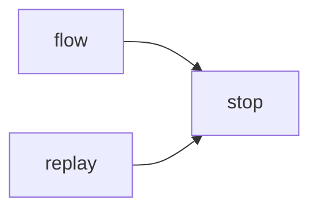

# Module `ariane.stop`

The reason a ticket stops (C23), split from `flow` so the replay and review round can raise it without importing the flow.

## Main types and functions

- `Stop`: `reason`, `next_action`, `detail` and `status` (`stopped`, or `needs a human`); the flow journals it and ends the ticket.

## Collaborations

Arrows go from the caller to the callee.

## Serves

C23; ADR 0006, ADR 0034. See [the component view](../3-components.md).
