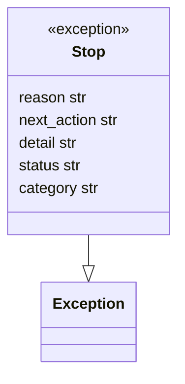
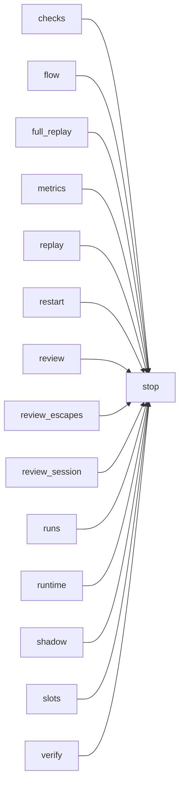

# Module `ariane.stop`

The reason a ticket stops (C23), split from `flow` so the replay and review round can raise it without importing the flow.

## Public API

| Name | Kind | What it does |
| --- | --- | --- |
| `SPEC` | constant | `spec`: the ticket was unclear (the implementer changed no file). |
| `GUARD` | constant | `guard`: the push guard or the tree guard refused a change. |
| `BUDGET` | constant | `budget`: a cost, token, turn or time limit stopped a session. |
| `RUNTIME` | constant | `runtime`: the agent CLI failed (error, login, quota, an answer invalid twice). |
| `CHECKS` | constant | `checks`: blocking checks still red after the rounds (or on the first replay). |
| `REVIEW` | constant | `review`: the review still `no-go` after the rounds. |
| `MERGE` | constant | `merge`: a conflict while updating the branch (reserved for the `update` command). |
| `CI` | constant | `ci`: the pull request's CI still red after the CI rounds (reserved for them). |
| `INFRA` | constant | `infra`: the setup, slot, lock, a leftover tree, the tracker, git, an interrupt or any other error. |
| `CATEGORIES` | constant | The nine categories, in that order: the fixed list `metrics.json` and `ariane report` use. |
| `category_of(exc)` | function | The category of whatever ended a run: a `Stop`'s own, `infra` for anything else (an error, Ctrl-C). |
| `describe(exc)` | function | The reason and the next action for whatever ended a run: a `Stop`, Ctrl-C (`interrupted by the user`) or an error (its first line); used by `start` and `shadow`. |
| `Stop` | exception | Ends the flow early; carries `reason`, `next_action`, `detail`, `status` (`stopped`, or `needs a human`) and `category` (`infra` unless the raiser names another). |

## Behaviour and errors

- `Stop` has no logic: the flow (or `verify`) catches it, journals it and ends the ticket with that reason, next action and status, and records its category in `metrics.json` (`Metrics.finish`, `Metrics.keep_stopped`).
- Every raiser names the category of its stop: the guard checks (`flow.verify`, `runs.guard_stop`, `runs.remote_stop`, the replay and reviewer trees, `checks`) say `guard`; an implementer session that did not finish says `budget` or `runtime` (`runtime.category`); no changed file says `spec`; blocking checks red on the first replay say `checks`; a reviewer failure keeps `ReviewFailed.category`. The merge and CI categories are reserved for the `update` command and the CI rounds, which do not exist yet.

## Workflow

No behaviour of its own: the replay and the flow raise `Stop`, the flow catches it.

## Code view (C4 level 4)

## Collaborations

Arrows go from the importing module to the imported module; a dashed arrow is an import for type checking only.

<!-- generated: collaborations -->

<!-- end generated -->

## Serves

C19, C23; ADR 0006, ADR 0034, ADR 0058. See [the component view](../3-components.md).
