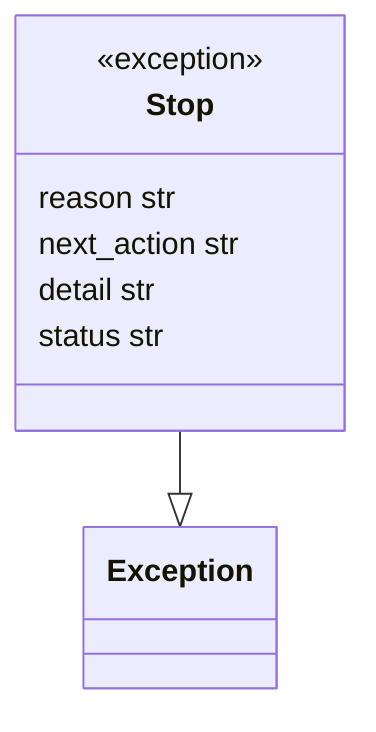
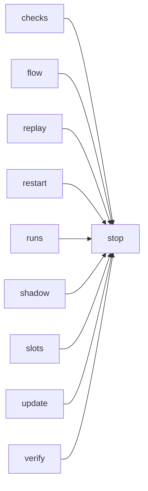

# Module `ariane.stop`

The reason a ticket stops (C23), split from `flow` so the replay and review round can raise it without importing the flow.

## Public API

| Name | Kind | What it does |
| --- | --- | --- |
| `describe(exc)` | function | The reason and the next action for whatever ended a run: a `Stop`, Ctrl-C (`interrupted by the user`) or an error (its first line); used by `start` and `shadow`. |
| `Stop` | exception | Ends the flow early; carries `reason`, `next_action`, `detail` and `status` (`stopped`, or `needs a human`). |

## Behaviour and errors

- `Stop` has no logic: the flow (or `verify`) catches it, journals it and ends the ticket with that reason, next action and status.

## Workflow

No behaviour of its own: the replay and the flow raise `Stop`, the flow catches it.

## Code view (C4 level 4)

## Collaborations

Arrows go from the importing module to the imported module; a dashed arrow is an import for type checking only.

<!-- generated: collaborations -->

<!-- end generated -->

## Serves

C23; ADR 0006, ADR 0034. See [the component view](../3-components.md).
