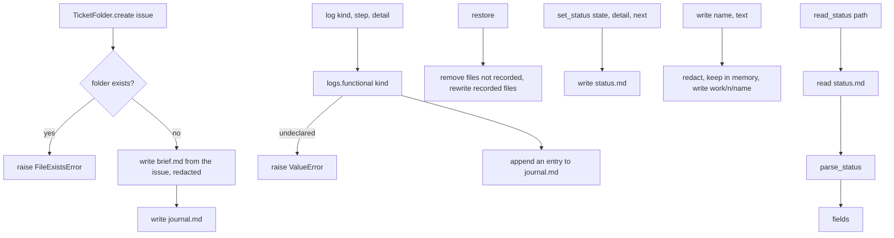
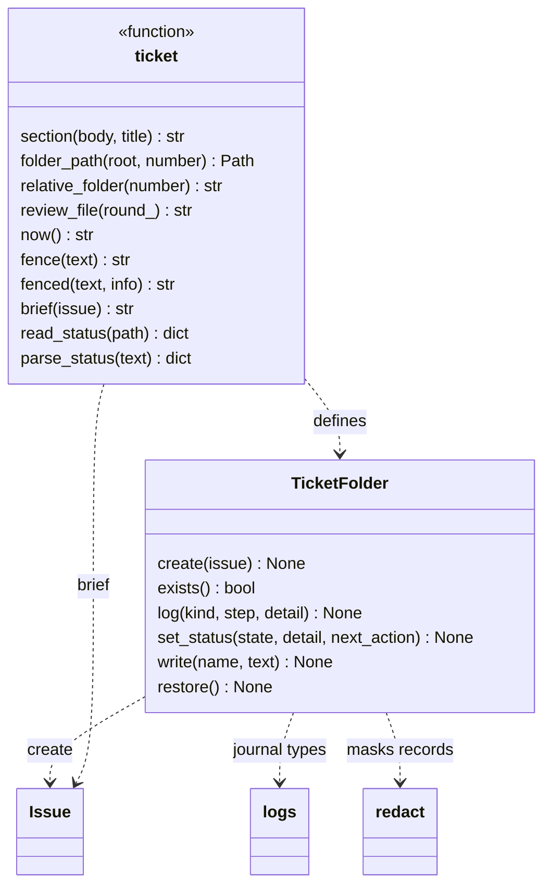
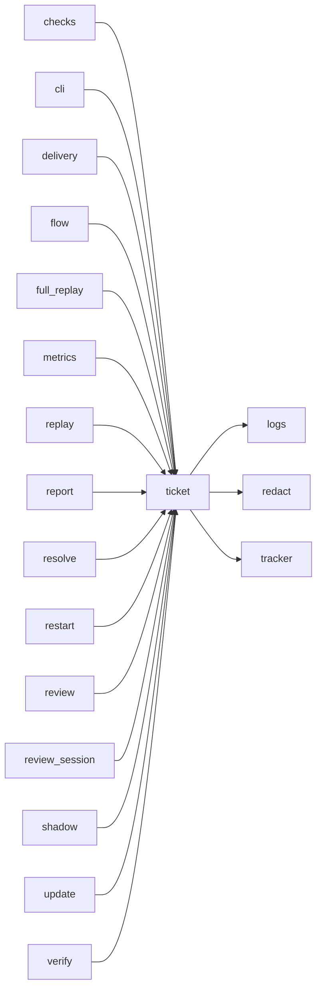

# Module `ariane.ticket`

The ticket folder `work/<n>/` (C1, C10, C23): every document of a ticket, readable without Ariane, with its status file and brief.

## Public API

| Name | Kind | What it does |
| --- | --- | --- |
| `WORK_DIR` | constant | The folder of all tickets, `work`. |
| `BRIEF` | constant | The brief file name, `brief.md`. |
| `JOURNAL` | constant | The journal file name, `journal.md`. |
| `STATUS` | constant | The status file name, `status.md`. |
| `CHECKS` | constant | The checks file name, `checks.md`. |
| `RECORDS` | constant | The four records every ticket folder holds. |
| `section(body, title)` | function | The text under the level-2 heading `## <title>` of an issue body (case and surrounding spaces ignored), up to the next level-2 heading; empty when absent. |
| `folder_path(root, number)` | function | The folder of ticket `number` under `root`. |
| `relative_folder(number)` | function | The folder as a path relative to the repository root. |
| `review_file(round_)` | function | The record of review `round_` (`review-0.md`, then `review-1.md` and `review-2.md` after fix rounds; an `ariane update` continues the numbering). |
| `now()` | function | The current time as the ISO string the records show. |
| `fence(text)` | function | A backtick fence longer than any backtick run inside `text`. |
| `fenced(text, info='text')` | function | `text` in a code block that it cannot close early (quotes untrusted text safely). |
| `TicketFolder` | class | Ariane's records of one ticket: `create(issue)`, `exists()`, `log(kind, step, detail='')`, `set_status(state, detail, next_action)`, `write(name, text)`, `restore()`; `load()` takes the regular files already in the folder as its records, `read(name)` and `names()` give them back (`ariane update`, ADR 0033). |
| `ensure_folder(root, path)` | function | Makes every folder from `root` down to `path` a real directory (a link or file in the way is removed). |
| `write_file(target, text)` | function | Writes a record; a link or folder in its place is removed, never followed. Also used by `verify` (ADR 0028). |
| `brief(issue)` | function | The issue as a document. |
| `read_status(path)` | function | Parse the `status.md` of a ticket folder into its fields (Last action, At, Detail, Next). |
| `parse_status(text)` | function | Parse status text in the current wording (Last action, At) or the old one (State, Updated). |

## Behaviour and errors

- `TicketFolder(root, number, secrets=())` writes under `root/work/<n>/`: `brief.md` and `journal.md` (from `create`), one entry per `log` appended to `journal.md`, `status.md` (`set_status`), `checks.md` and the `review-<round>.md` files (through `write`). Every text is redacted with the given secrets before it is written, and kept in memory. `write` and `log` hold a lock, so the replay's worker threads can journal at the same time (ADR 0052).
- `create` raises `FileExistsError` when the ticket folder already exists. `log` raises `ValueError` for an undeclared type (`logs.functional`) and emits `journal.warning` for an entry of level warning.
- `restore` rewrites the folder exactly as recorded in memory, whatever an agent did (removing other files, links and folders); `exists` tells whether the journal was written.
- `read_status` reads `status.md` of a folder; `parse_status` accepts the current and the old wording and returns fields missing from the text as absent.
- `section` never raises: it stops at the next `## ` line, keeps `###` headings inside the section, runs to the end of the body when no heading follows, and returns `""` when absent. It reads lines, not Markdown: a `## ` line inside a fenced code block ends the section.
- A journal entry of an undeclared type is refused by `logs.functional`.

## Workflow

## Code view (C4 level 4)

## Collaborations

Arrows go from the importing module to the imported module; a dashed arrow is an import for type checking only.

<!-- generated: collaborations -->

<!-- end generated -->

## Serves

C1, C10, C23; ADR 0019. See [the component view](../3-components.md).
