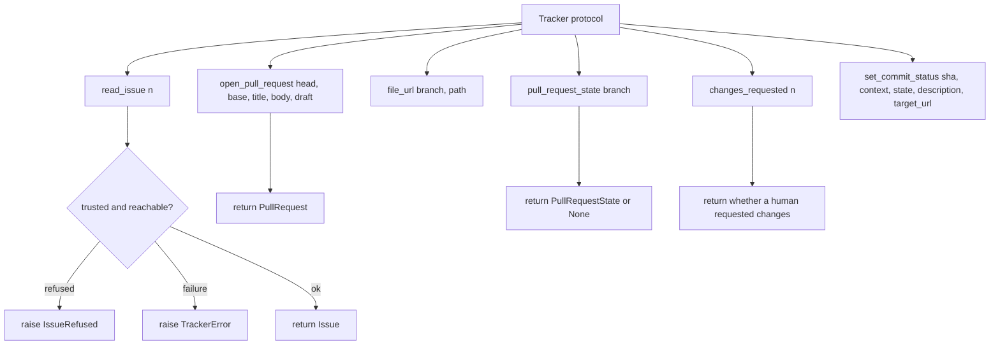
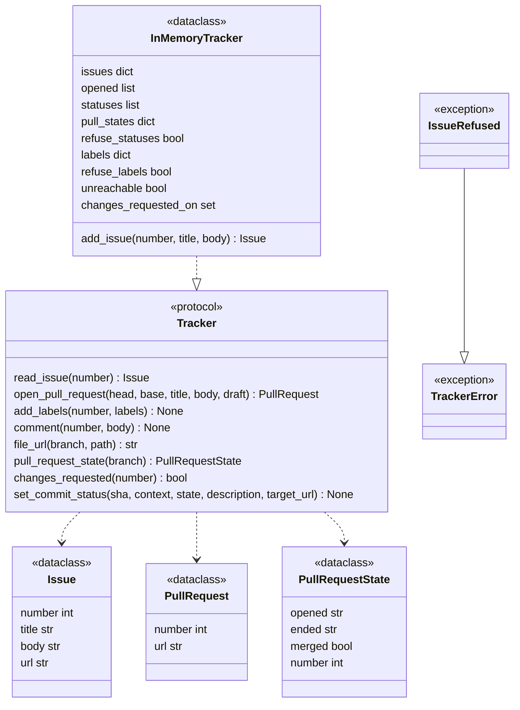
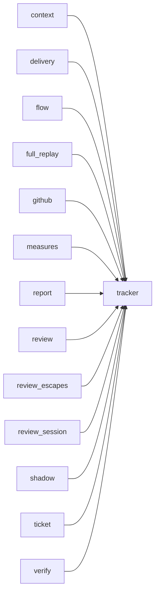

# Module `ariane.tracker`

The tracker interface (C1, C10): the only way Ariane talks to GitHub, another forge or a test double.

## Public API

| Name | Kind | What it does |
| --- | --- | --- |
| `TrackerError` | exception | The tracker refused or failed a request. |
| `IssueRefused` | exception | A `TrackerError` for an issue not trusted to run (C21, ADR 0032); the commands exit 2. |
| `Issue` | dataclass | An issue: `number`, `title`, `body`, `url`. |
| `PullRequest` | dataclass | A pull request: `number`, `url`. |
| `PullRequestState` | dataclass | When a pull request opened and ended (merged or closed): `opened`, `ended` (empty while open), `merged`, `number` (0 when not known). |
| `Tracker` | protocol | `read_issue`, `open_pull_request`, `add_labels`, `comment`, `file_url`, `pull_request_state`, `changes_requested`, `set_commit_status`. |
| `InMemoryTracker` | dataclass | The tracker double used by tests; it records pull requests (with their draft flag) and statuses. |

## Behaviour and errors

- `open_pull_request(..., draft=False)`: a draft pull request is not ready to merge (C10).
- `pull_request_state(branch)`: when the latest pull request from a branch opened and ended, and its number, for the report (C19, ADR 0038), or None.
- `changes_requested(number)`: whether a human, not a bot account, left a "changes requested" review on pull request `number`; one of the facts after a `go` that make a review escape in the report (C10, C19, ADR 0058). Nothing is posted.
- `InMemoryTracker` takes `issues`, `pull_states`, `refuse_statuses`, `refuse_labels`, `refuse_comments`, `changes_requested_on` (the pull request numbers `changes_requested` says yes for) and `unreachable`; `comment` records the comments per pull request in `comments`, or raises `TrackerError` when `refuse_comments`; `add_labels` records the labels per pull request in `labels`, or raises `TrackerError` when `refuse_labels`; `read_issue` raises `TrackerError` for an unknown issue, for a pull request number, or when `unreachable`; `set_commit_status` raises it when `refuse_statuses`, and `pull_request_state` and `changes_requested` when `unreachable`. It reads and writes no file.
- `IssueRefused` is a `TrackerError`, so a caller that handles tracker failures also handles a refused issue.

## Workflow

## Code view (C4 level 4)

## Collaborations

Arrows go from the importing module to the imported module; a dashed arrow is an import for type checking only.

<!-- generated: collaborations -->

<!-- end generated -->

## Serves

C1, C10, C19; ADR 0007, ADR 0027, ADR 0058. See [the component view](../3-components.md).
