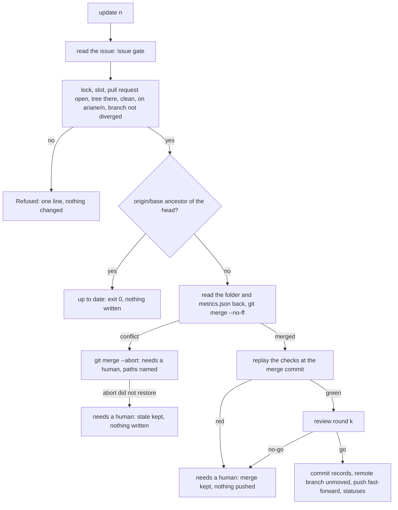
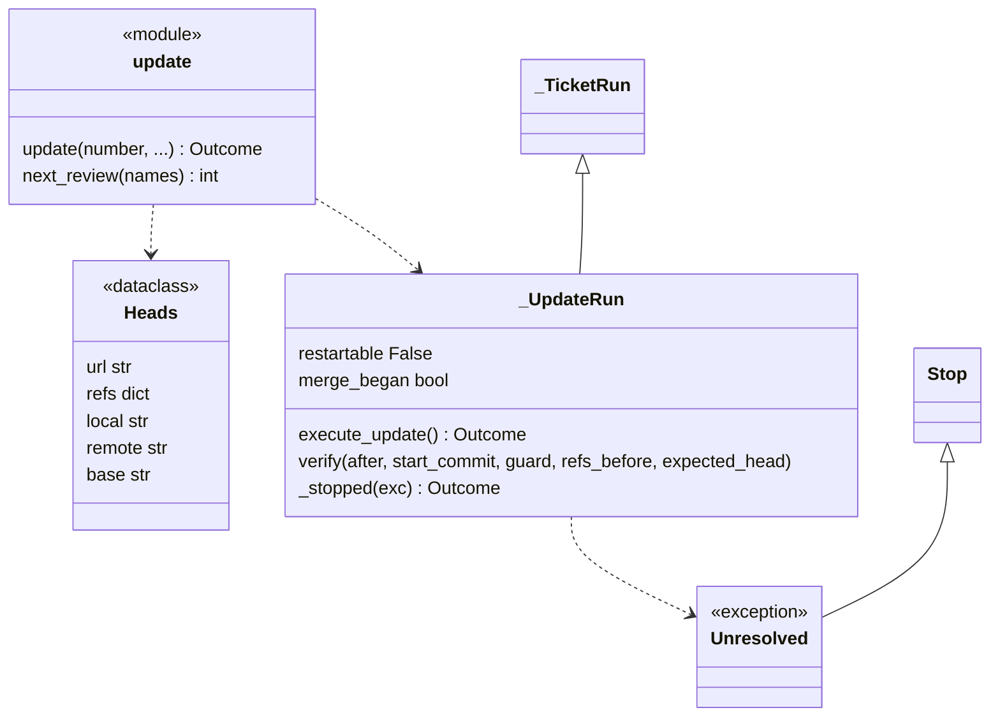
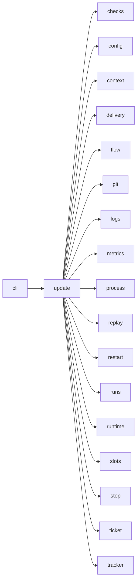

# Module `ariane.update`

`ariane update <n>` (C9, C10, C11, C23; ADR 0033): when the base branch has moved, it merges the remote base branch into a delivered ticket's branch `ariane/<n>` with a merge commit, in the ticket's working tree (never a rebase or a force-push), replays the checks on the merge commit as `ariane start` does, runs one review, and on `go` with green blocking checks pushes the branch again as a fast-forward: the pull request updates by itself. It is the documented second push of a ticket (C11). The run is a `flow._TicketRun` continued (`_UpdateRun`): the ticket folder and `metrics.json` are read back, the replay, the review round, the guard and the stop are `start`'s.

## Public API

| Name | Kind | What it does |
| --- | --- | --- |
| `NEEDS_A_HUMAN` | constant | `needs a human`, the status of every stop after the merge began (Ctrl-C excepted: `stopped`). |
| `Unresolved` | exception | A `Stop`: a failed merge that `git merge --abort` did not undo; nothing is written. |
| `Refused` | exception | The ticket cannot be updated, before any change; carries `reason` and `next_action`. |
| `Heads` | dataclass | Where the update starts: the push `url`, the remote's `refs` (read once), the `local` head, the `remote` branch's head and the remote `base`. |
| `next_review(names)` | function | The number of the next review record: one more than the highest `review-<k>.md` of `names`, else 0. |
| `update(number, ...)` | function | The entry point; returns a `flow.Outcome`. |

## Behaviour and errors

- The issue is read through the issue gate first (`Tracker.read_issue`), as for `start`: a refused issue exits with the tracker's code. The label must be added again after the pull request referenced the issue.
- Then, before any change, it holds the ticket lock (`restart.locked`: "ticket #<n> is running in another Ariane process") and a machine-wide slot (ADR 0050), and refuses, each with one line and a next action, exit 1: no pull request from `ariane/<n>` (`Tracker.pull_request_state`), or a merged or closed one; the ticket's working tree (`flow.worktree_path`) missing; that tree with uncommitted changes; its branch not `ariane/<n>`; `ariane/<n>` not on `origin`; the local branch not the remote branch's head or a descendant of it whose extra commits each change only `work/<n>/` (the records committed after the delivery's push, ADR 0027; read with `git log --name-only --diff-merges=separate` over the extra commits, a merge against each parent, so a change followed by its revert is refused): "the local branch ariane/<n> diverged from origin/ariane/<n>".
- Up to date: when the fetched `origin/<base>` is an ancestor of the head, "Ticket #<n> is up to date with <base>. Next: nothing.", exit 0; nothing is written in the repository, and the technical log has `ticket.update.up_to_date`.
- Merge: `git merge --no-ff --no-edit origin/<base>` in the ticket's working tree with the untrusted environment and Ariane's identity (commit hooks may run), then the guard of `flow` ("the merge"), the history checked from the head the update started at. The merge commit's parents must be that head and the fetched base. The journal gets `ticket.update.started` and `ticket.update.merged`; `metrics.json` its `updates` count plus one (once the merge is run, even if it fails) and the step `base merged`.
- Conflict: the conflicting paths are read, then `git merge --abort`, before any record is written; the abort must succeed and leave no `MERGE_HEAD`, a clean tree and the head the update started at. Then the stop "merging origin/<base> conflicts in <paths>", status `needs a human`, the paths in the journal; the next action merges by hand and runs `ariane verify ariane/<n>`. Nothing is pushed.
- Abort not undone (it failed, or left changes, for example from a hook): `Unresolved`, "merging origin/<base> failed (conflicts in <paths>) and `git merge --abort` did not restore ariane/<n>", exit 1, `needs a human` in the line. Nothing is written, committed or pushed: the record commit of a stop would reset the unresolved index and hide the conflict, so the state is left as git left it for a human.
- Replay and review: the checks are replayed at the merge commit (`replay.replay`), the changed files and the reviewer's diff taken from the fetched base to the merge commit, without `work/`; then one review round `k` (`replay.review_round`), its record `review-<k>.md` with `k` from `next_review`. A red blocking check (no review then) or a `no-go` stops with status `needs a human`: nothing pushed, the merge kept on the local branch, the stop recorded and committed there.
- Push: `delivery.Delivery.push_update`: the records committed under `work/<n>/` (`#<n>: record the update`), the head checked to differ from the merge commit only there, then the last guard: `ariane/<n>` on `origin` must still be at the head read when the update began ("ariane/<n> moved on origin during the update", nothing pushed), and the guard of `flow` ("the delivery"); then `git.push` of the head with `expected` the remote head read at the start: a fast-forward from it, leased on it, so a branch moved or deleted after that last read is refused by the remote atomically (a `git push failed` stop, nothing pushed); `ticket.update.pushed`, one commit status per check on the pushed head, and the status `delivered` committed on the local branch only. No pull request is opened. A refusal of the delivery (`delivery.PullRequestRefused`: the head differs from the merge commit outside `work/<n>/`, or a URL rewrite applies to the push URL) becomes a stop with status `needs a human`, recorded and committed like any other; nothing is pushed.
- Metrics: `metrics.json` is read back (`Metrics.resume`) and extended: the delivery's steps and sessions are kept, the update's added, and the outcome becomes the update's (`delivered`, or the stop's status).
- Ctrl-C or a git, tracker or file error after the refusals is a stop of `flow` (`_TicketRun._stopped`), never naming `--restart`: the branch is pushed. Once the merge began, every stop of status `stopped` and every error (a rejected push lease included) is recorded as `needs a human`; Ctrl-C stays `stopped`.

## Workflow

## Code view (C4 level 4)

## Collaborations

Arrows go from the importing module to the imported module; a dashed arrow is an import for type checking only.

<!-- generated: collaborations -->

<!-- end generated -->

## Serves

C9, C10, C11, C19, C23; ADR 0033. See [the component view](../3-components.md).
