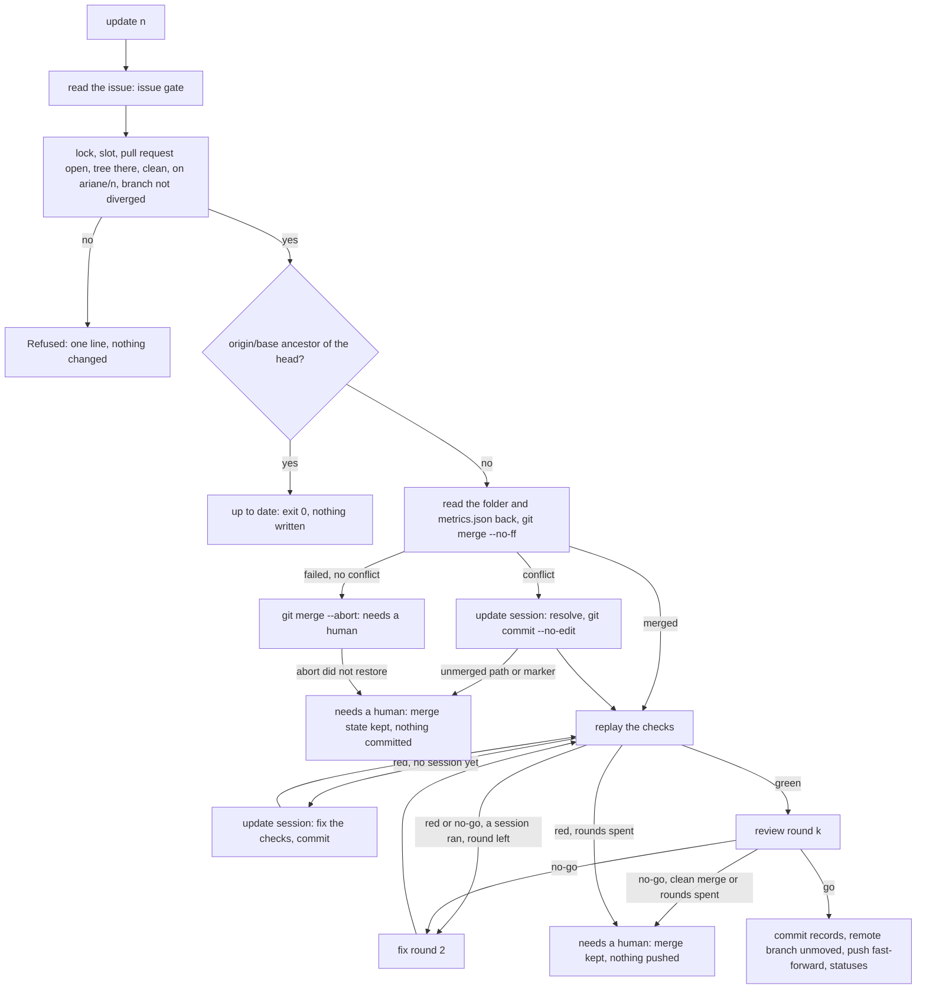
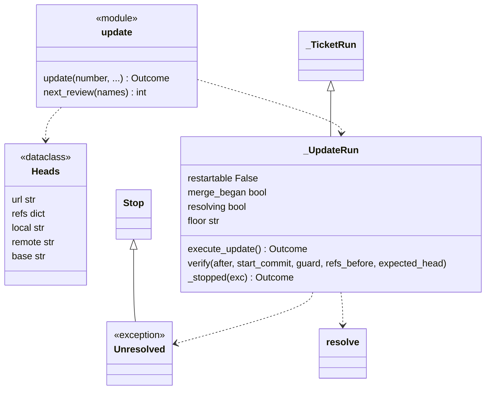
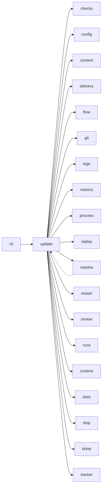

# Module `ariane.update`

`ariane update <n>` (C9, C10, C11, C23; ADR 0033): when the base branch has moved, it merges the remote base branch into a delivered ticket's branch `ariane/<n>` with a merge commit, in the ticket's working tree (never a rebase or a force-push), replays the checks on the merge commit as `ariane start` does, runs one review (a conflict or a check the merge broke first goes to one implementer session, [resolve](resolve.md), then a fix round may follow), and on `go` with green blocking checks pushes the branch again as a fast-forward: the pull request updates by itself. It is the documented second push of a ticket (C11). The run is a `flow._TicketRun` continued (`_UpdateRun`): the ticket folder and `metrics.json` are read back, the replay, the review round, the guard and the stop are `start`'s.

## Public API

| Name | Kind | What it does |
| --- | --- | --- |
| `NEEDS_A_HUMAN` | constant | `needs a human`, the status of every stop after the merge began (Ctrl-C excepted: `stopped`). |
| `Refused` | exception | The ticket cannot be updated, before any change; carries `reason` and `next_action`. |
| `Heads` | dataclass | Where the update starts: the push `url`, the remote's `refs` (read once), the `local` head, the `remote` branch's head and the remote `base`. |
| `next_review(names)` | function | The number of the next review record: one more than the highest `review-<k>.md` of `names`, else 0. |
| `update(number, ...)` | function | The entry point; returns a `flow.Outcome`. |

## Behaviour and errors

- The issue is read through the issue gate first (`Tracker.read_issue`), as for `start`: a refused issue exits with the tracker's code. The label must be added again after the pull request referenced the issue.
- Then, before any change, it holds the ticket lock (`restart.locked`: "ticket #<n> is running in another Ariane process") and a machine-wide slot (ADR 0050), and refuses, each with one line and a next action, exit 1: no pull request from `ariane/<n>` (`Tracker.pull_request_state`), or a merged or closed one; the ticket's working tree (`flow.worktree_path`) missing; that tree with uncommitted changes; its branch not `ariane/<n>`; its `work/<n>/` holding an entry that is not a plain file (a folder or a link, committed or ignored; `_not_records`): "the ticket's folder work/<n>/ holds <names>, which are not plain record files", since `ticket.TicketFolder.load` keeps only plain files and `restore` removes the rest; after the fetch, a base that changed `work/<n>/` since its fork point with the ticket (`_base_records`, `git diff --no-renames --name-only <head>...<base>`): "origin/<base> changes the ticket's records (<paths>)"; `ariane/<n>` not on `origin`; the local branch not the remote branch's head or a descendant of it whose extra commits each change only `work/<n>/` (the records committed after the delivery's push, ADR 0027; read with `git log --name-only --diff-merges=separate` over the extra commits, a merge against each parent, so a change followed by its revert is refused): "the local branch ariane/<n> diverged from origin/ariane/<n>". Then, still before any write, the ticket folder and `metrics.json` are read back (`TicketFolder.load`, all or nothing; a file that is not UTF-8 is an `OSError`): a failed or interrupted read ends with "Did not update ticket #<n>: ..." and writes, removes and commits nothing. A failure before the run exists (the issue read, Ctrl-C, the lock, a slot, the registry, git, the records read back) records its category with `metrics.keep_refused`, in its own folder, without touching the delivery's `metrics.json` (ADR 0058); a refusal for the ticket's state (`Refused`) records none.
- Up to date: when the remote's base, as `ls-remote` lists it, is a commit the repository has and an ancestor of the head, the update ends before any fetch (no `FETCH_HEAD`, tracking ref or reflog written); otherwise it fetches and compares the fetched `origin/<base>`. Up to date: "Ticket #<n> is up to date with <base>. Next: nothing.", exit 0; nothing is written in the repository, and the technical log has `ticket.update.up_to_date`.
- Checks selected (ADR 0056): from the ticket's diff from the base and from what the merge brings from the base (the ticket's head before the merge to the merge commit, `incoming_from`), both sides of a rename included (`git.changes`), so a check scoped to files only the base changed, or moved out of, still runs; the review's diff stays the ticket's own. The review's accepted residuals (ADR 0057) are read from the base commit (`review.accepted_residuals` at the fetched base), never from the ticket's working tree, which holds the delivered change.
- Merge: `git merge --no-ff --no-edit origin/<base>` in the ticket's working tree with the untrusted environment and Ariane's identity (no hook runs: every git command Ariane runs sets `core.hooksPath` to the null device), then the guard of `flow` ("the merge"), the history checked from the head the update started at. The merge commit's parents must be that head and the fetched base. The journal gets `ticket.update.started` and `ticket.update.merged`; `metrics.json` its `updates` count plus one (once the merge is run, even if it fails) and the step `base merged`.
- `resolve.Unresolved` is the stop of a merge neither finished nor undone (an abort that did not restore the tree, conflicts the update session left): nothing is committed and the state is kept for a human.
- Conflict (the merge fails and `git ls-files -u` lists paths, `resolve.unmerged`): the merge is left in progress, `ticket.update.started` journaled, the guard run with the head expected where the update started, then `resolve.resolve_conflicts`: one implementer session whose task is the conflicting paths (`ticket.update.implementer`), then the checks of its resolution and `git commit --no-edit`; the merge commit's parents are checked as for a clean merge. A path left unmerged or with a conflict marker line, in its file or its staged blob: `Unresolved`, "the update session left conflicts in <paths>", the next action finishing the merge by hand and running `ariane verify ariane/<n>`.
- A merge that fails without a conflict is aborted (`git merge --abort`) before any record is written; the abort must succeed and leave no `MERGE_HEAD`, a clean tree and the head the update started at; then the stop "git merge of origin/<base> failed", status `needs a human`. Abort not undone (it failed, or left changes, for example from a hook): `Unresolved`, "merging origin/<base> failed and `git merge --abort` did not restore ariane/<n>", exit 1, `needs a human` in the line. Nothing is written, committed or pushed: the record commit of a stop would reset the unresolved index and hide the merge state, so the state is left as git left it for a human.
- Merge left half done (Ctrl-C, a stop or an error while merging, inspecting, aborting or during the update session, once the merge began): if the tree has a `MERGE_HEAD` or unmerged paths, or git cannot tell, the same `Unresolved` path: "merging origin/<base> is neither finished nor undone: <reason>", nothing committed, the merge state kept (`_merge_pending`). Before the update session nothing is written either; once it ran (`resolving`), its journal entries are in the tree already, so the stop, the status `needs a human` and `metrics.json` (with the stop's category) are written there too, uncommitted.
- Replay and review: the checks are replayed at the merge commit (`replay.replay`), the changed files and the reviewer's diff taken from the fetched base to the head, without `work/`; with green blocking checks, one review round `k` (`replay.review_round`), its record `review-<k>.md` with `k` from `next_review`.
- Rounds (C10): blocking checks red after a clean merge go to one implementer session (`resolve.session` with `resolve.checks_task`: the failing checks' names and outputs), whose work Ariane commits as `#<n>: fix after merging <base>`; then the replay and the review again. The update session, for a conflict or for red checks, counts as the first of `flow.MAX_FIX_ROUNDS`: after it, red blocking checks or a `no-go` go to one fix round exactly as in `start` (`_fix`, fix round 2, the findings and failing checks given as data), then the replay and the review once more. An update thus runs at most two implementer sessions. A `no-go` on a clean merge with green checks, red checks or a `no-go` with the rounds spent, an update session that left the head where it was ("blocking checks failed after the merge: <names>, and the update session changed nothing") or a fix round that did ("fix round 2 of the update changed nothing"), stop with status `needs a human`: nothing pushed, the merge kept on the local branch, the stop recorded and committed there. The guard checks the history from the head the update started at, then from the merge commit (`floor`).
- Push: `delivery.Delivery.push_update`: the records committed under `work/<n>/` (`#<n>: record the update`), the head checked to differ from the merge commit only there, then the last guard: `ariane/<n>` on `origin` must still be at the head read when the update began ("ariane/<n> moved on origin during the update", nothing pushed), and the guard of `flow` ("the delivery"); then `git.push` of the head with `expected` the remote head read at the start: a fast-forward from it, leased on it, so a branch moved or deleted after that last read is refused by the remote atomically (a `git push failed` stop, nothing pushed); `ticket.update.pushed`, one commit status per check on the pushed head, and the status `delivered` committed on the local branch only. No pull request is opened. A refusal of the delivery (`delivery.PullRequestRefused`: the head differs from the merge commit outside `work/<n>/`, or a URL rewrite applies to the push URL) becomes a stop with status `needs a human`, recorded and committed like any other; nothing is pushed.
- Metrics: `metrics.json` is read back (`Metrics.resume`) and extended: the delivery's steps and sessions are kept, the update's added, and the outcome becomes the update's (`delivered`, or the stop's status).
- Ctrl-C or a git, tracker or file error after the refusals is a stop of `flow` (`_TicketRun._stopped`), never naming `--restart`: the branch is pushed. Once the merge began, every stop of status `stopped` and every error (a rejected push lease included) is recorded as `needs a human`; Ctrl-C stays `stopped`. Each stop records its category (C19, ADR 0058): `merge` for conflicts the update session left, `checks` for blocking checks still red after the rounds, `review` for the update's `no-go` after them, `guard` for `ariane/<n>` moved on `origin` or a merge commit with unexpected parents, else `stop.category_of` (`infra`); a refusal before any change records none. `restartable` is false, so no stop names `--restart`; `pushed` is set by the update's own push only, so a stop before it takes back the `pushed` mark of the update's `go` and keeps the delivery's (ADR 0058).

## Workflow

## Code view (C4 level 4)

## Collaborations

Arrows go from the importing module to the imported module; a dashed arrow is an import for type checking only.

<!-- generated: collaborations -->

<!-- end generated -->

## Serves

C9, C10, C11, C19, C23; ADR 0033. See [the component view](../3-components.md).
