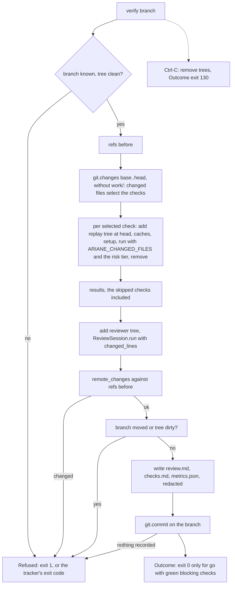
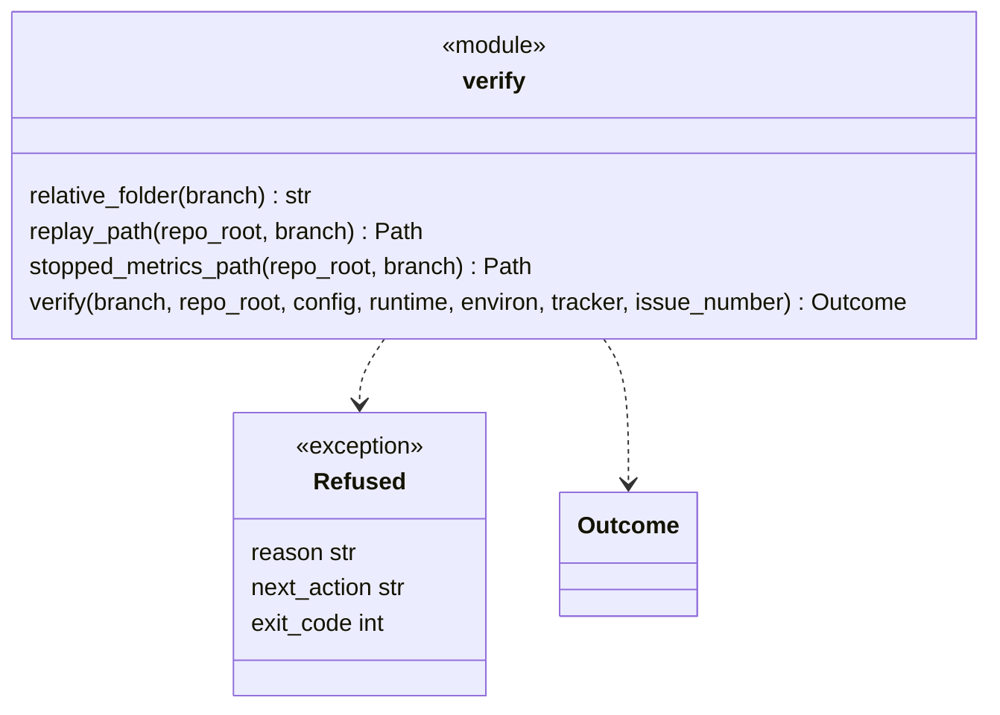
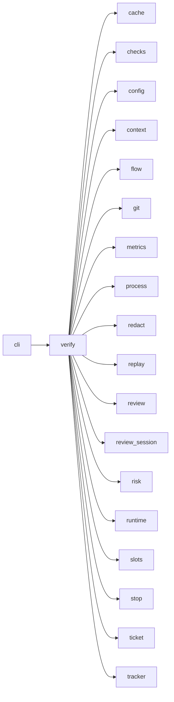

# Module `ariane.verify`

`ariane verify`: checks and reviews a local branch finished by hand (C10, C23). It replays each check in its own clean working tree at the branch's head, after the setup (`verify-<slug>-<k>`, ADR 0041), runs one read-only review on a separate tree without instruction files or `.claude/` (ADR 0031), and commits `work/verify/<branch>/review.md` and `checks.md` (redacted) on top of the branch. It never pushes. Before anything else it holds the run's machine-wide slot (`slots.held`, ADR 0050) until it returns, and gives it as `ARIANE_SLOT` to the setup, the checks, the reviewer and the commit hooks; `review.md` names it in a `Run` section; with `project.parallel_checks` above 1 it replays that many checks at the same time with `replay.replay_each`, its own slot for the first worker and the next free ones (`slots.several`) for the others, each given as `ARIANE_SLOT` to its worker's setup and check, and the `Run` section says how many ran at once, in which slots, and when fewer slots were free than wanted (`replay.parallel_note`, ADR 0052); with all 16 held it refuses ("16 Ariane runs already hold a slot on this machine. Next: wait for one to end.", exit 1). It also compares the remote's refs before and after the checks and the reviewer, with the rule of ADR 0017 (the branch, the base branch and tags are watched; other branches are ignored), and refuses when one changed. The agent environment is the allow list of `context.untrusted_environment` with the `[project] env` entries and the login variables of the reviewer's model, or of the small reviewer's model for a small change (`review_session.agent_logins`, ADR 0046); the setup and the checks get the same without the login variables (ADR 0024). Just before committing it checks again that the branch has not moved and is checked out where it was, in a clean tree; otherwise it refuses without committing. When nothing is committed (for example `work/` is ignored) it exits 1 with "nothing was recorded".

## Public API

| Name | Kind | What it does |
| --- | --- | --- |
| `VERIFY_DIR` | constant | The folder of the committed records, `work/verify`. |
| `REVIEW` | constant | The name of the review record, `review.md`. |
| `PUSH_NEXT` | constant | The next action after a green verification. |
| `FIX_NEXT` | constant | The next action after findings or red checks. |
| `Refused` | exception | The branch cannot be verified; carries `reason`, `next_action`, `exit_code` and `category` (the stop category, ADR 0058: `guard` for the guard's refusals, a reviewer failure's own, else `infra`). |
| `relative_folder(branch)` | function | The records folder of a branch, relative to the repository. |
| `replay_path(repo_root, branch)` | function | Where the replay trees of a branch are (the name of tree `k` ends in `-<k>`). |
| `stopped_metrics_path(repo_root, branch)` | function | Where a run that committed nothing keeps its `metrics.json`: `<repo>.ariane/verify/<branch slug>/metrics.json`. |
| `verify(branch, ...)` | function | The entry point; returns an `Outcome`. |

## Behaviour and errors

- `verify`: the entry point; returns an `Outcome` whose line gives the checks' summary, the verdict and the next action. Exit 0 only for a `go` with green blocking checks. Ctrl-C (`KeyboardInterrupt`, also raised through a killed reviewer or setup process tree) gives exit 130 (`EXIT_INTERRUPTED`) and the line "Stopped verifying <branch>: interrupted by the user. Next: run verify again."; the replay tree and the temporary records folder are removed and nothing is committed or journaled.
- Stop categories (C19, ADR 0058): the metrics a verification keeps outside the repository after a refusal record the refusal's category (any other error, Ctrl-C included, is `infra`); a committed verification that is not green records `checks` when a blocking check is red, else `review`. The review records its verdict and number of findings in the reviewer session (`Metrics.reviewed`).
- `Refused`: carries the exit code and next action; a tracker refusal (`TrackerError`, `IssueRefused`) passes its own through, so an issue refused by the issue gate (C21, ADR 0032) gives exit 2 before any checkout or review. The branch cannot be verified (unknown branch, uncommitted changes in the working tree that holds it, failed setup or reviewer).
- Metrics (C19): the records also hold `metrics.json` (mode `verify`, the reviewer sessions, survivors and guard violations, outcome `delivered` when green, else `stopped`); a refused or interrupted run writes it to `stopped_metrics_path` instead.
- Changed files' listing (ADR 0056): after each check the replay tree must show no change but the listing's own path (`checks.without_listing`), which Ariane never removes by name: the tree's removal takes it.
- Git guard (C11, ADR 0017, ADR 0028): a snapshot of git (as `ariane start` takes) is taken before the first check and compared after every check and the reviewer, before any other git command; a change is refused with the wording of `start`. The base branch's instructions are read once, before the first check. The remote-tracking ref of the base branch is part of the snapshot, and so are the instruction files the reviewer can load from outside its tree (`git.instruction_snapshot`; a change is refused as "changed instruction files the reviewer can load"). After every check and the reviewer, the replay tree must still be detached at the branch's head: one `git.detached_head` (one git process, `rev-parse HEAD --symbolic-full-name HEAD`, instead of `symbolic-ref` and `rev-parse HEAD`, ADR 0053), with the branch's ref read separately; a moved head is refused as "<step> moved a head". Each command's teardown kills what it left running (`process.kill_survivors`); the snapshot is compared right after each setup, before its check runs; after each setup (before a failing setup is refused), check and reviewer session, what was killed (`process.take_killed`) is counted in `metrics.json` and refused as a guard violation, and on any end of `run` (a refusal, Ctrl-C) the survivors are killed again and counted. A run that commits nothing (a refusal, Ctrl-C) writes its `metrics.json` (outcome `stopped`) to `stopped_metrics_path` before the temporary records folder is removed (ADR 0031). The review prompt gets the untruncated `git diff --name-status` of the branch, and a cut diff is journaled with the missing files; since that journal is temporary, the committed `review.md` ends with a `Diff given to the reviewer` section naming them (ADR 0031).
- Selective checks (C9, ADR 0056): before the first check it reads the diff, its name status and the changed lines from the base to the head in one git process (`git.changes`, without `work/`, ADR 0053); the changed files (`checks.changed_files`, renames on both sides) select the checks as for a ticket (`replay.replay_each` with `changed`, `project.check_all_paths` and the records folder `work/<n>/` of the issue): a check not selected is `skipped` in `checks.md`, and each check that runs gets `ARIANE_CHANGED_FILES`.
- Risk tier (C9, ADR 0056): the same read gives the replay's tier (`checks.risk_tier` with `[checks_policy]` and `project.check_all_paths`; no earlier round, so no failed one): each check gets `ARIANE_RISK_TIER` and `ARIANE_FULL_SUITE`, `checks.md` starts with the tier, and `ReviewSession` gets it (stated in the prompt; a measured `high` keeps the full review), with the accepted residuals of the ADRs at the merge base and the changed files matching `[review] sensitive_paths` (ADR 0057; `verify` opens no pull request, so no label).
- Sensitive paths (C10, ADR 0057): the reviewer is told the changed files matching `[review] sensitive_paths`, taken from `checks.changed_files` of the name-status listing (decoded, both sides of a rename), as in a ticket's review.
- Review size (C10, ADR 0046): the same read gives the review its diff, name status and changed lines (a binary file counting 0), and verify passes the count to `ReviewSession`, which uses `[agents.reviewer.small]` and the narrower prompt when the count is at most `max_lines` and records `changed_lines` with the reviewer session in `metrics.json`; `review.md` names the model of the selected reviewer.
- Dependency caches (C9, ADR 0054): each replay tree gets its `[[project.cache]]` folders before its setup (`cache.prepare` on `<repo>.ariane/cache` with `fill=True`: copied from the store, else built by the cache's own setup, guarded like the setup, and stored); after each build, before it is stored, and after each copy, before the next setup, the tree must still be detached at the branch's head ("a cache setup moved a head"), have no tracked or staged change ("a cache setup changed files that git tracks") and hold no file git does not ignore ("the dependency caches left files that git does not ignore"); `review.md` then has a `Dependency caches` section, one line per check with each cache hit or built. `verify` does not prune the store.
- Records: written with `ticket.ensure_folder` and `ticket.write_file` (a symlink is replaced, never followed) and committed as regular files: each record path leaves the index first.
- `replay_path`, `relative_folder`: where the replay tree and the records are.

## Workflow

## Code view (C4 level 4)

## Collaborations

Arrows go from the importing module to the imported module; a dashed arrow is an import for type checking only.

<!-- generated: collaborations -->

<!-- end generated -->

## Serves

C10, C23; ADR 0016, ADR 0020, ADR 0028, ADR 0034, ADR 0046, ADR 0053, ADR 0054, ADR 0056, ADR 0058, C19. See [the component view](../3-components.md).
