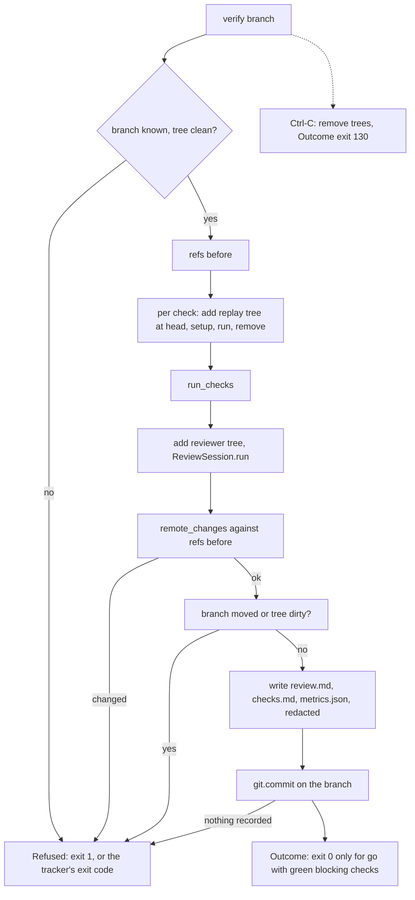
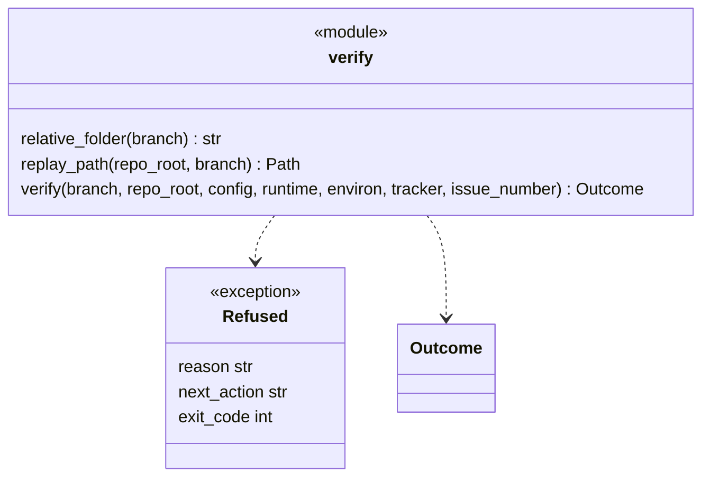
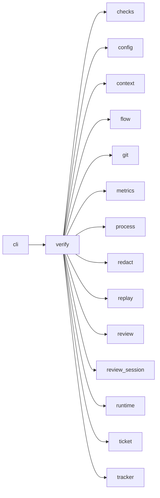

# Module `ariane.verify`

`ariane verify`: checks and reviews a local branch finished by hand (C10, C23). It replays each check in its own clean working tree at the branch's head, after the setup (`verify-<slug>-<k>`, ADR 0041), runs one read-only review on a separate tree without instruction files or `.claude/` (ADR 0031), and commits `work/verify/<branch>/review.md` and `checks.md` (redacted) on top of the branch. It never pushes. It also compares the remote's refs before and after the checks and the reviewer, with the rule of ADR 0017 (the branch, the base branch and tags are watched; other branches are ignored), and refuses when one changed. The agent environment is the reviewer's runtime's own. Just before committing it checks again that the branch has not moved and is checked out where it was, in a clean tree; otherwise it refuses without committing. When nothing is committed (for example `work/` is ignored) it exits 1 with "nothing was recorded".

## Public API

| Name | Kind | What it does |
| --- | --- | --- |
| `VERIFY_DIR` | constant | The folder of the committed records, `work/verify`. |
| `REVIEW` | constant | The name of the review record, `review.md`. |
| `PUSH_NEXT` | constant | The next action after a green verification. |
| `FIX_NEXT` | constant | The next action after findings or red checks. |
| `Refused` | exception | The branch cannot be verified; carries `reason`, `next_action` and `exit_code`. |
| `relative_folder(branch)` | function | The records folder of a branch, relative to the repository. |
| `replay_path(repo_root, branch)` | function | Where the replay trees of a branch are (the name of tree `k` ends in `-<k>`). |
| `verify(branch, ...)` | function | The entry point; returns an `Outcome`. |

## Behaviour and errors

- `verify`: the entry point; returns an `Outcome` whose line gives the checks' summary, the verdict and the next action. Exit 0 only for a `go` with green blocking checks. Ctrl-C (`KeyboardInterrupt`, also raised through a killed reviewer or setup process tree) gives exit 130 (`EXIT_INTERRUPTED`) and the line "Stopped verifying <branch>: interrupted by the user. Next: run verify again."; the replay tree and the temporary records folder are removed and nothing is committed or journaled.
- `Refused`: carries the exit code and next action; a tracker refusal (`TrackerError`, `IssueRefused`) passes its own through, so an issue refused by the issue gate (C21, ADR 0032) gives exit 2 before any checkout or review. The branch cannot be verified (unknown branch, uncommitted changes in the working tree that holds it, failed setup or reviewer).
- Metrics (C19): the records also hold `metrics.json` (mode `verify`, the reviewer sessions, outcome `delivered` when green, else `stopped`).
- Git guard (C11, ADR 0017, ADR 0028): a snapshot of git (as `ariane start` takes) is taken before the first check and compared after every check and the reviewer, before any other git command; a change is refused with the wording of `start`. The base branch's instructions are read once, before the first check. The remote-tracking ref of the base branch is part of the snapshot, and so are the instruction files the reviewer can load from outside its tree (`git.instruction_snapshot`; a change is refused as "changed instruction files the reviewer can load"). Each command's teardown kills what it left running (`process.kill_survivors`); after each setup (before a failing setup is refused), check and reviewer session, what was killed (`process.take_killed`) is counted in `metrics.json` and refused, and on any end of `run` (a refusal, Ctrl-C) the survivors are killed again before the records folder is removed. The review prompt gets the untruncated `git diff --name-status` of the branch, and a cut diff is journaled with the missing files (ADR 0031).
- Records: written with `ticket.ensure_folder` and `ticket.write_file` (a symlink is replaced, never followed) and committed as regular files: each record path leaves the index first.
- `replay_path`, `relative_folder`: where the replay tree and the records are.

## Workflow

## Code view (C4 level 4)

## Collaborations

Arrows go from the importing module to the imported module; a dashed arrow is an import for type checking only.

<!-- generated: collaborations -->

<!-- end generated -->

## Serves

C10, C23; ADR 0016, ADR 0020, ADR 0028, ADR 0034, C19. See [the component view](../3-components.md).
